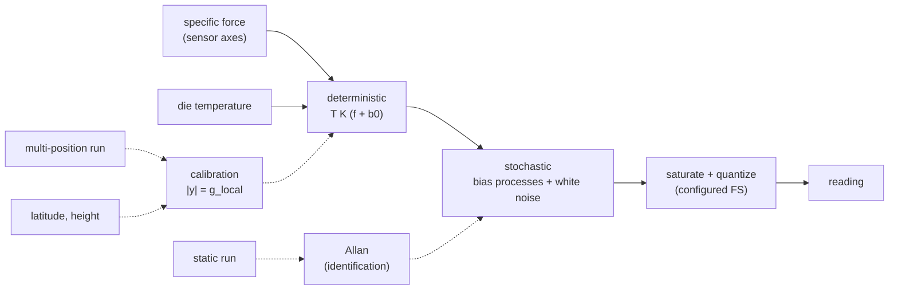

# Accelerometer Model (accelerometer-model)


---

### 1. Introduction

The accelerometer family models a 3-axis MEMS accelerometer: what it
reports for a given specific force, and how each term of that error is
identified from bench recordings. It is a family in the sense of
`sensor-model-pipeline-design.md`: it supplies an error model, its
identification procedures and its recording run types, and it is timeless.
Bandwidth, sampling and latency belong to `measurement-timing-design.md`.

The reference part is the LSM6DSOX accelerometer. Its datasheet values are
typical, not guaranteed (STMicroelectronics, 2024), so they serve as
priors and test fixtures, never as shipped parameters.

Scenarios:

- **A1 Characterize.** A user records a static run and a hand-held
  multi-position run, and identifies the accelerometer's deterministic and
  stochastic terms without a rate table or other fixture.
- **A2 Simulate.** A simulation passes specific force and temperature to
  the model and receives the reading the part would produce.
- **A3 Reference the gyroscope.** The calibrated accelerometer is the
  attitude reference for gyroscope calibration (`gyroscope-model`).

---

### 2. Requirements

#### 2.1 Functional Requirements

- **FR-1 — Deterministic error terms**: The model must apply axis
  misalignment, per-axis scale factor and per-axis bias to the true
  specific force (Pretto and Grisetti, 2014). Without them a static
  identification alone leaves scale-factor errors unaccounted for
  (ethz-asl, 2016).
- **FR-2 — Stochastic error terms**: The model must apply white noise,
  bias random walk and bias instability per axis, at the sample interval it
  is called with (ethz-asl, 2016).
- **FR-3 — Range and resolution**: Output must saturate at the configured
  full scale and quantize to the configured sensitivity
  (STMicroelectronics, 2024).
- **FR-4 — Temperature input**: The model must accept die temperature and
  apply linear zero-g and sensitivity temperature coefficients. The part
  specifies both (STMicroelectronics, 2024); C-1 bounds their
  identification.
- **FR-5 — Equipment-free calibration**: Misalignment, scale factor and
  bias must be identifiable from a hand-held multi-position recording, in
  which the norm of each static reading equals local gravity (Pretto and
  Grisetti, 2014), with static intervals detected automatically and no
  parameter tuning (Tedaldi et al., 2014).
- **FR-6 — Local gravity reference**: The calibration reference must be
  local gravity magnitude, from latitude and height on the reference
  ellipsoid (AHRS, 2026) or supplied directly by the user.
- **FR-7 — Stochastic identification**: White-noise density, bias
  instability and bias random walk must be identified from a static
  recording through the shared Allan machinery of `identification`
  (MathWorks, 2026).
- **FR-8 — Configuration-specific parameters**: A parameter set must name
  the full-scale and power-mode configuration it was identified under,
  because noise density changes with full scale (STMicroelectronics, 2024).

#### 2.2 Non-Functional Requirements

- **NFR-1 — Calibration conditioning**: Calibration must report the
  conditioning of its estimate and refuse to return parameters when the
  recorded orientations do not constrain all of them.

#### 2.3 Constraints

- **C-1 — Temperature coefficients not identified**: Temperature
  coefficients are user-supplied or datasheet priors in this revision; no
  thermal run type is defined.
- **C-2 — Static-only errors**: Dynamic errors (vibration rectification,
  cross-coupling under motion) are out of scope; static data does not
  establish them (ethz-asl, 2016).

---

### 3. Technical Overview



Required expertise: inertial sensor calibration and nonlinear least
squares.

---

### 4. Architecture

#### 4.1 Error Model

For true specific force $f$ in sensor axes and die temperature $T_d$:

```latex
y = Q\Big(\mathrm{sat}\big(T_a K_a(T_d)\,(f + b_0(T_d) + b_k) + n_k\big)\Big)
```

- $T_a$: misalignment, unit diagonal with small off-diagonal terms (Pretto
  and Grisetti, 2014).
- $K_a(T_d) = K_a(1 + \kappa (T_d - T_0))$: diagonal scale with the
  sensitivity temperature coefficient (STMicroelectronics, 2024).
- $b_0(T_d) = b_0 + \beta (T_d - T_0)$: turn-on bias with the zero-g
  temperature coefficient (STMicroelectronics, 2024).
- $b_k$: bias random walk plus bias instability; $n_k$: white noise; both
  discretized at the call's sample interval by `model-core` (ethz-asl,
  2016).
- $\mathrm{sat}$ and $Q$ from the configured full scale and its
  sensitivity (STMicroelectronics, 2024).

The model takes one truth sample per call and no time (overview FR-10).

#### 4.2 Run Types

| Run type | Procedure | Identifies |
|:--|:--|:--|
| `static` | Stationary on a damped surface, at least 3 hours (Buchanan, 2026) | White noise, bias instability, bias random walk |
| `multi-position` | Hand-held, 36 to 50 distinct static orientations (Pretto and Grisetti, 2014) | $T_a$, $K_a$, $b_0$ |

Both run types are registered with `recording`, and each recording names
its full-scale and power-mode configuration (FR-8).

#### 4.3 Calibration

1. Static intervals are detected automatically from the signal (Tedaldi et
   al., 2014).
2. Each interval's mean reading $\bar y_i$ is one observation.
3. $T_a$, $K_a$ and $b_0$ minimize
   $\sum_i (\lVert T_a K_a (\bar y_i - b_0) \rVert - g)^2$, using the
   model's inverse, by Gauss-Newton with QR steps (assumption: the exact
   cost of the cited method is not quoted in the research file).
4. Local gravity $g$ comes from the normal-gravity formula at the user's
   latitude and height (AHRS, 2026), or from the user.
5. NFR-1: the Jacobian's condition number is reported; above a threshold
   the calibration returns an error naming the unconstrained parameters.

The calibrated accelerometer is the reference for `gyroscope-model`.

#### 4.4 Stochastic Identification

The static run, corrected by the calibrated deterministic terms, goes to
`identification`, which fits white noise, bias instability and bias random
walk from the overlapping Allan deviation with chi-squared intervals
(Riley, 2008).

#### 4.5 Parameter Set and Reference Part

The parameter set holds $T_a$, $K_a$, $b_0$, $\kappa$, $\beta$, $T_0$ and the
three stochastic intensities, each with unit, uncertainty and provenance,
plus the configuration of FR-8. LSM6DSOX datasheet values (for example,
±20 mg zero-g offset and 70 to 110 µg/√Hz noise density by full scale)
(STMicroelectronics, 2024) appear only in tests and examples (overview
C-2).

#### 4.6 Module Layout

| Path | Contents | Build |
|:--|:--|:--|
| `src/sim/accelerometer.rs` | Error model and parameter set | `no_std` |
| `src/fit/accelerometer.rs` | Static detection, calibration, gravity reference | `std` |

---

### 5. Alternatives

- **Six-position calibration on a fixture.** Aligning the part to six
  faces of a cube needs a fixture and leaves misalignment poorly
  constrained. Many hand-held orientations constrain all nine
  deterministic parameters without equipment (Pretto and Grisetti, 2014).
- **Fixed 9.80665 m/s².** A standard gravity is simple, but local gravity
  varies with latitude and height (AHRS, 2026), and that variation enters
  the scale factor directly.
- **Turn-on bias drawn per run.** Sampling bias once at start (Open
  Robotics, 2026) suits a population of parts, not the part that was
  calibrated. The model uses the calibrated $b_0$ and offers the draw only
  for unidentified parts.

---

### 6. Verification & Validation

#### 6.1 Verification

| Condition | Requirement | Method | Target | Criterion |
|:--|:--|:--|:--|:--|
| VC-1.1 | FR-1 | `libtest` | `control_rs_sensors::sim::accelerometer::tests::deterministic_terms` | With noise off, output equals $T_a K_a (f + b_0)$ quantized for generated $f$; FR-1 holds iff this condition holds |
| VC-2.1 | FR-2 | `libtest` | `control_rs_sensors::sim::accelerometer::tests::stochastic_allan` | The Allan deviation of synthesized static output matches the configured intensities within §6.2; FR-2 holds iff this condition holds |
| VC-3.1 | FR-3 | `libtest` | `control_rs_sensors::sim::accelerometer::tests::saturation_quantization` | Output never exceeds full scale and is an integer multiple of the sensitivity; FR-3 holds iff this condition holds |
| VC-4.1 | FR-4 | `libtest` | `control_rs_sensors::sim::accelerometer::tests::temperature_coefficients` | A temperature step of $\Delta T$ changes bias by $\beta \Delta T$ and scale by $\kappa \Delta T$ exactly with noise off; FR-4 holds iff this condition holds |
| VC-5.1 | FR-5 | `libtest` | `control_rs_sensors::fit::accelerometer::tests::multi_position_recovery` | $T_a$, $K_a$, $b_0$ recovered from a synthesized 40-orientation run meet §6.2; FR-5 holds iff all conditions hold |
| VC-5.2 | FR-5 | `libtest` | `control_rs_sensors::fit::accelerometer::tests::static_detection` | Static intervals detected in a synthesized run match the generated intervals within one sample at each edge |
| VC-6.1 | FR-6 | `libtest` | `control_rs_sensors::fit::accelerometer::tests::normal_gravity` | Normal gravity at the equator and poles matches the ellipsoid's equatorial and polar values within §6.2; FR-6 holds iff this condition holds |
| VC-7.1 | FR-7 | `libtest` | `control_rs_sensors::fit::accelerometer::tests::stochastic_recovery` | Intensities recovered from a synthesized static run meet §6.2; FR-7 holds iff this condition holds |
| VC-8.1 | FR-8 | `libtest` | `control_rs_sensors::fit::accelerometer::tests::configuration_recorded` | A parameter set built from a recording carries that recording's full scale and power mode, and applying it under another configuration is an error; FR-8 holds iff this condition holds |
| VC-9.1 | NFR-1 | `libtest` | `control_rs_sensors::fit::accelerometer::tests::underdetermined_rejected` | A run whose orientations all share one axis returns an error naming the unconstrained parameters; NFR-1 holds iff this condition holds |
| VC-10.1 | C-1 | `libtest` | `control_rs_sensors::fit::accelerometer::tests::temperature_passthrough` | Calibration output carries the user-supplied temperature coefficients unchanged; C-1 holds iff this condition holds |
| VC-11.1 | C-2 | `libtest` | `control_rs_sensors::fit::accelerometer::tests::static_runs_only` | Calibration accepts only `static` and `multi-position` run types; C-2 holds iff this condition holds |

Coverage: 90 % line coverage of `sim::accelerometer` and
`fit::accelerometer`, measured with `cargo tarpaulin`.

#### 6.2 Acceptance

| Claim | Oracle | Measure | Bound |
|:--|:--|:--|:--|
| Stochastic match and recovery (VC-2.1, VC-7.1) | Manufactured solution | Relative error per intensity | Inside the 95 % chi-squared interval for the run's degrees of freedom (Riley, 2008) |
| Multi-position recovery (VC-5.1) | Manufactured solution with known $T_a$, $K_a$, $b_0$ | Absolute error per parameter | Within 3 standard deviations of the Gauss-Newton covariance |
| Normal gravity (VC-6.1) | Closed-form equatorial and polar values of the formula (AHRS, 2026) | Relative error | Below $10^{-12}$ in `f64` |

#### 6.3 Limits

- Real-part fidelity rests on acceptance runs (`model-acceptance`), not on
  these tests.
- The normal-gravity formula is checked against itself; the primary NGA
  standard was not retrieved.

---

### 8. Risks & Open Questions

- **Cost function.** The calibration cost in §4.3 is an assumption to check
  against the cited method.
- **Gravity source.** The normal-gravity formula is cited from a secondary
  summary (AHRS, 2026); the primary WGS84 standard should replace it.
- **Thermal runs.** Identifying $\kappa$ and $\beta$ needs a thermal run
  type, deferred by C-1.
- **Conditioning threshold.** The NFR-1 threshold is not yet chosen.

---

### 9. Development Plan

| Phase | Delivers | Requirements | Effort | Status |
|:--|:--|:--|:--|:--|
| 1. Model | Error model, parameter set, temperature terms | FR-1, FR-2, FR-3, FR-4, FR-8 | 2 days | Planned |
| 2. Calibration | Static detection, gravity reference, multi-position calibration, conditioning | FR-5, FR-6, NFR-1, C-1, C-2 | 3 days | Planned |
| 3. Stochastic identification | Static run through `identification` | FR-7 | 1 day | Planned |

---

### 10. Revision History

| Revision | Date | Author | Description |
|:--|:--|:--|:--|
| 1.0 | October 30, 2026 | @MitchellDScott, Claude | Initial design: FR-1 to FR-8, NFR-1, C-1, C-2. |

---

## References

[1] STMicroelectronics, "LSM6DSOX: iNEMO inertial module with Machine
    Learning Core, Finite State Machine and advanced Digital Functions,"
    STMicroelectronics, Datasheet DS12814 Rev 4, 2024. [Online]. Available:
    https://www.st.com/resource/en/datasheet/lsm6dsox.pdf. Accessed:
    Oct. 30, 2026.

[2] A. Pretto and G. Grisetti, "Calibration and performance evaluation of
    low-cost IMUs," in *Proc. 20th IMEKO TC4 Int. Symp.*, Benevento, Italy,
    2014, pp. 429–434.

[3] ethz-asl, "IMU Noise Model," *kalibr GitHub wiki*. [Online]. Available:
    https://github.com/ethz-asl/kalibr/wiki/IMU-Noise-Model. Accessed:
    Oct. 30, 2026.

[4] D. Tedaldi, A. Pretto, and E. Menegatti, "imu_tk README," in
    *Kyle-ak/imu_tk*, implementing "A robust and easy to implement method
    for IMU calibration without external equipments," Proc. IEEE ICRA,
    Hong Kong, China, 2014, pp. 3042–3049. [Online]. Available:
    https://github.com/Kyle-ak/imu_tk. Accessed: Oct. 30, 2026.

[5] AHRS, "World Geodetic System (1984)," *AHRS documentation*. [Online].
    Available: https://ahrs.readthedocs.io/en/stable/wgs84.html. Accessed:
    Oct. 30, 2026.

[6] MathWorks, "Inertial Sensor Noise Analysis Using Allan Variance,"
    *Navigation Toolbox documentation*. [Online]. Available:
    https://ch.mathworks.com/help/nav/ug/inertial-sensor-noise-analysis-using-allan-variance.html.
    Accessed: Oct. 30, 2026.

[7] R. Buchanan, *allan_variance_ros*: Allan variance computation for IMU
    rosbags (BSD-3-Clause). Oxford Robotics Institute, DRS Lab. [Online].
    Available: https://github.com/ori-drs/allan_variance_ros. Accessed:
    Oct. 30, 2026.

[8] W. J. Riley, "Handbook of frequency stability analysis," National
    Institute of Standards and Technology, Boulder, CO, USA, NIST Special
    Publication 1065, 2008.

[9] Open Robotics, "Tutorial: Sensor noise model," *Gazebo classic
    tutorials*. [Online]. Available:
    https://classic.gazebosim.org/tutorials?tut=sensor_noise. Accessed:
    Oct. 30, 2026.
