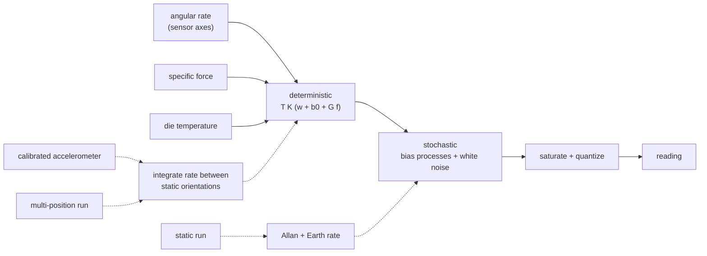

# Gyroscope Model (gyroscope-model)


---

### 1. Introduction

The gyroscope family models a 3-axis MEMS gyroscope: what it reports for a
given angular rate and specific force, and how each error term is
identified from bench recordings without a rate table. It is a timeless
family of `sensor-model-pipeline-design.md`; bandwidth, sampling and
latency belong to `measurement-timing-design.md`.

The reference part is the LSM6DSOX gyroscope, whose datasheet values are
typical, not guaranteed (STMicroelectronics, 2024). Calibration uses the
calibrated accelerometer as its reference (Pretto and Grisetti, 2014), so
this document depends on `accelerometer-model-design.md` and confirms the
dependency assumed in the overview's document map.

Scenarios:

- **G1 Characterize.** A user identifies the gyroscope from the same
  static and multi-position runs used for the accelerometer.
- **G2 Simulate.** A simulation passes angular rate, specific force and
  temperature and receives the reading the part would produce, including
  its response to linear acceleration.

---

### 2. Requirements

#### 2.1 Functional Requirements

- **FR-1 — Deterministic error terms**: The model must apply axis
  misalignment, per-axis scale factor and per-axis bias to the true angular
  rate (Pretto and Grisetti, 2014).
- **FR-2 — Linear-acceleration sensitivity**: The model must add a bias
  proportional to specific force, the gyroscope's linear-acceleration
  effect on bias (Scannell and Looney, n.d.). Without it, tilt and
  manoeuvres degrade bias stability by orders of magnitude (Scannell and
  Looney, n.d.).
- **FR-3 — Stochastic error terms**: The model must apply white noise
  (angle random walk), bias instability and bias random walk per axis, at
  the sample interval it is called with (ethz-asl, 2016).
- **FR-4 — Range, resolution and temperature**: Output must saturate at
  the configured full scale, quantize to its sensitivity and apply linear
  zero-rate and sensitivity temperature coefficients (STMicroelectronics,
  2024).
- **FR-5 — Rate-table-free calibration**: Misalignment and scale factor
  must be identifiable by integrating angular rate between static
  orientations and comparing the predicted gravity direction with the
  calibrated accelerometer's (Pretto and Grisetti, 2014).
- **FR-6 — Earth-rate-aware bias**: Static bias must account for Earth
  rotation (AHRS, 2026) when latitude and orientation are known, and carry
  its magnitude as uncertainty otherwise.
- **FR-7 — Stochastic identification**: Angle random walk, bias
  instability and bias random walk must be identified from a static
  recording through the shared Allan machinery of `identification`
  (MathWorks, 2026).

#### 2.2 Non-Functional Requirements

- **NFR-1 — Calibration conditioning**: Calibration must report its
  conditioning and refuse to return parameters the recorded rotations do
  not constrain.

#### 2.3 Constraints

- **C-1 — No vibration rectification**: The g×g (rectified) term is out of
  scope: it is difficult to observe and rarely specified (Scannell and
  Looney, n.d.).
- **C-2 — Accelerometer first**: Gyroscope calibration requires an
  accelerometer parameter set identified from the same multi-position run.
- **C-3 — Temperature coefficients not identified**: As for the
  accelerometer, temperature coefficients are user-supplied or priors in
  this revision.

---

### 3. Technical Overview



Required expertise: rotation kinematics, inertial calibration and
nonlinear least squares.

---

### 4. Architecture

#### 4.1 Error Model

For true angular rate $\omega$ and specific force $f$ in sensor axes:

```latex
y = Q\Big(\mathrm{sat}\big(T_g K_g(T_d)\,(\omega + b_0(T_d) + G f + b_k) + n_k\big)\Big)
```

- $T_g$, $K_g$, $b_0$ and the temperature terms as in the accelerometer
  family (Pretto and Grisetti, 2014; STMicroelectronics, 2024).
- $G$: 3×3 linear-acceleration sensitivity, specified in °/s/g (Scannell
  and Looney, n.d.).
- $b_k$, $n_k$: bias processes and white noise discretized by `model-core`
  (ethz-asl, 2016).

The model takes one sample of $\omega$, $f$ and $T_d$ per call and no time.

#### 4.2 Run Types

The gyroscope reuses the accelerometer's runs; no gyroscope-specific run
type is needed.

| Run type | Identifies |
|:--|:--|
| `static` (at least 3 hours (Buchanan, 2026)) | $b_0$, angle random walk, bias instability, bias random walk |
| `multi-position` (36 to 50 orientations (Pretto and Grisetti, 2014)) | $T_g$, $K_g$, $G$ |

#### 4.3 Calibration

1. Static intervals and the calibrated accelerometer come from
   `accelerometer-model` (C-2).
2. Between consecutive static intervals, the bias-corrected rate is
   integrated to predict the gravity direction at the next interval, which
   is compared with the accelerometer's (Pretto and Grisetti, 2014).
3. $T_g$ and $K_g$ minimize the angular mismatch over all transitions by
   Gauss-Newton with QR steps (assumption: integration scheme and cost are
   not quoted in the research file).
4. $G$ is a least-squares regression of each static interval's mean rate
   on its mean specific force: across 36 to 50 orientations gravity
   projects onto every axis (assumption to verify: the interval means are
   accurate enough to resolve $G$).
5. NFR-1: the condition number of each fit is reported.

#### 4.4 Static Bias and Earth Rate

A stationary gyroscope measures Earth rotation, 7.292115×10⁻⁵ rad/s
(AHRS, 2026), projected on its axes. With latitude and the static
orientation known, that projection is subtracted from the static mean;
otherwise its magnitude is added to the bias uncertainty (FR-6). The
corrected static run then goes to `identification` for the Allan terms
(Riley, 2008).

#### 4.5 Parameter Set and Reference Part

The parameter set holds $T_g$, $K_g$, $b_0$, $G$, temperature terms and the
three stochastic intensities with unit, uncertainty and provenance, plus
the full-scale configuration. LSM6DSOX values (±1 dps zero-rate level,
3.8 mdps/√Hz rate noise density (STMicroelectronics, 2024)) appear only in
tests and examples.

#### 4.6 Module Layout

| Path | Contents | Build |
|:--|:--|:--|
| `src/sim/gyroscope.rs` | Error model and parameter set | `no_std` |
| `src/fit/gyroscope.rs` | Rotation-integration calibration, $G$ regression, Earth-rate correction | `std` |

---

### 5. Alternatives

- **Rate table.** A rate table gives scale factor directly but is equipment
  most users lack. Integration against the calibrated accelerometer needs
  only hand-held motion (Pretto and Grisetti, 2014).
- **Ignore linear-acceleration sensitivity.** Simpler, but the effect is a
  specified term that dominates bias stability under tilt (Scannell and
  Looney, n.d.).
- **Ignore Earth rate.** Earth rate is small against the reference part's
  ±1 dps zero-rate level (STMicroelectronics, 2024), but not against a
  well-averaged static bias; carrying it as uncertainty costs nothing.

---

### 6. Verification & Validation

#### 6.1 Verification

| Condition | Requirement | Method | Target | Criterion |
|:--|:--|:--|:--|:--|
| VC-1.1 | FR-1 | `libtest` | `control_rs_sensors::sim::gyroscope::tests::deterministic_terms` | With noise and $G$ off, output equals $T_g K_g (\omega + b_0)$ quantized; FR-1 holds iff this condition holds |
| VC-2.1 | FR-2 | `libtest` | `control_rs_sensors::sim::gyroscope::tests::g_sensitivity` | At zero rate, output equals $T_g K_g G f$ quantized for generated $f$ with other terms off; FR-2 holds iff this condition holds |
| VC-3.1 | FR-3 | `libtest` | `control_rs_sensors::sim::gyroscope::tests::stochastic_allan` | The Allan deviation of synthesized static output matches the configured intensities within §6.2; FR-3 holds iff this condition holds |
| VC-4.1 | FR-4 | `libtest` | `control_rs_sensors::sim::gyroscope::tests::range_resolution_temperature` | Output never exceeds full scale, is a multiple of the sensitivity, and a temperature step shifts bias and scale by the configured coefficients; FR-4 holds iff this condition holds |
| VC-5.1 | FR-5 | `libtest` | `control_rs_sensors::fit::gyroscope::tests::rotation_calibration_recovery` | $T_g$, $K_g$ recovered from a synthesized 40-orientation run meet §6.2; FR-5 holds iff all conditions hold |
| VC-5.2 | FR-5 | `libtest` | `control_rs_sensors::fit::gyroscope::tests::g_sensitivity_recovery` | $G$ recovered from the same run meets §6.2 |
| VC-6.1 | FR-6 | `libtest` | `control_rs_sensors::fit::gyroscope::tests::earth_rate_removed` | With known latitude and orientation, the recovered bias of a synthesized static run excludes the Earth-rate projection within §6.2; without them, the bias uncertainty includes its magnitude; FR-6 holds iff this condition holds |
| VC-7.1 | FR-7 | `libtest` | `control_rs_sensors::fit::gyroscope::tests::stochastic_recovery` | Intensities recovered from a synthesized static run meet §6.2; FR-7 holds iff this condition holds |
| VC-8.1 | NFR-1 | `libtest` | `control_rs_sensors::fit::gyroscope::tests::underdetermined_rejected` | A run whose rotations share one axis returns an error naming the unconstrained parameters; NFR-1 holds iff this condition holds |
| VC-9.1 | C-1 | `libtest` | `control_rs_sensors::sim::gyroscope::tests::no_rectification` | Zero-mean vibration of specific force produces zero mean output change with $G$ off; C-1 holds iff this condition holds |
| VC-10.1 | C-2 | `libtest` | `control_rs_sensors::fit::gyroscope::tests::requires_accelerometer` | Calibration without an accelerometer parameter set from the same run returns an error; C-2 holds iff this condition holds |
| VC-11.1 | C-3 | `libtest` | `control_rs_sensors::fit::gyroscope::tests::temperature_passthrough` | Calibration output carries the user-supplied temperature coefficients unchanged; C-3 holds iff this condition holds |

Coverage: 90 % line coverage of `sim::gyroscope` and `fit::gyroscope`,
measured with `cargo tarpaulin`.

#### 6.2 Acceptance

| Claim | Oracle | Measure | Bound |
|:--|:--|:--|:--|
| Stochastic match and recovery (VC-3.1, VC-7.1) | Manufactured solution | Relative error per intensity | Inside the 95 % chi-squared interval (Riley, 2008) |
| Calibration and $G$ recovery (VC-5.1, VC-5.2) | Manufactured solution with known $T_g$, $K_g$, $G$ | Absolute error per parameter | Within 3 standard deviations of the fit covariance |
| Earth-rate correction (VC-6.1) | Closed-form projection of Earth rate (AHRS, 2026) | Absolute error of bias | Within 3 standard deviations of the static-mean uncertainty |

#### 6.3 Limits

- Real-part fidelity rests on acceptance runs, not on these tests.
- Rectified (g×g) error is not modeled (C-1).

---

### 8. Risks & Open Questions

- **Calibration cost and integrator.** §4.3 steps 3 and 4 are assumptions
  to check against the cited method.
- **Reference-part sensitivity.** The LSM6DSOX linear-acceleration
  sensitivity was not found in the retrieved datasheet.
- **Bibliographic gap.** Scannell and Looney has no year or venue in the
  research file.
- **Earth-rate source.** The rotation rate is cited from a secondary
  summary (AHRS, 2026).

---

### 9. Development Plan

| Phase | Delivers | Requirements | Effort | Status |
|:--|:--|:--|:--|:--|
| 1. Model | Error model with $G$, temperature terms, parameter set | FR-1, FR-2, FR-3, FR-4, C-1 | 2 days | Planned |
| 2. Calibration | Rotation integration, $G$ regression, conditioning | FR-5, NFR-1, C-2, C-3 | 4 days | Planned |
| 3. Static identification | Earth-rate correction, Allan through `identification` | FR-6, FR-7 | 1 day | Planned |

---

### 10. Revision History

| Revision | Date | Author | Description |
|:--|:--|:--|:--|
| 1.0 | October 30, 2026 | @MitchellDScott, Claude | Initial design: FR-1 to FR-7, NFR-1, C-1 to C-3. |

---

## References

[1] STMicroelectronics, "LSM6DSOX: iNEMO inertial module with Machine
    Learning Core, Finite State Machine and advanced Digital Functions,"
    STMicroelectronics, Datasheet DS12814 Rev 4, 2024. [Online]. Available:
    https://www.st.com/resource/en/datasheet/lsm6dsox.pdf. Accessed:
    Oct. 30, 2026.

[2] A. Pretto and G. Grisetti, "Calibration and performance evaluation of
    low-cost IMUs," in *Proc. 20th IMEKO TC4 Int. Symp.*, Benevento, Italy,
    2014, pp. 429–434.

[3] B. Scannell and M. Looney, "Dynamic angle estimation with inertial
    MEMS," Analog Devices. [Online]. Available:
    https://www.analog.com/media/en/technical-documentation/technical-articles/Attitude-Sensing-in-Highly-Dynamic-Inertial-Conditions.pdf.
    Accessed: Oct. 30, 2026.

[4] ethz-asl, "IMU Noise Model," *kalibr GitHub wiki*. [Online]. Available:
    https://github.com/ethz-asl/kalibr/wiki/IMU-Noise-Model. Accessed:
    Oct. 30, 2026.

[5] AHRS, "World Geodetic System (1984)," *AHRS documentation*. [Online].
    Available: https://ahrs.readthedocs.io/en/stable/wgs84.html. Accessed:
    Oct. 30, 2026.

[6] MathWorks, "Inertial Sensor Noise Analysis Using Allan Variance,"
    *Navigation Toolbox documentation*. [Online]. Available:
    https://ch.mathworks.com/help/nav/ug/inertial-sensor-noise-analysis-using-allan-variance.html.
    Accessed: Oct. 30, 2026.

[7] R. Buchanan, *allan_variance_ros*: Allan variance computation for IMU
    rosbags (BSD-3-Clause). Oxford Robotics Institute, DRS Lab. [Online].
    Available: https://github.com/ori-drs/allan_variance_ros. Accessed:
    Oct. 30, 2026.

[8] W. J. Riley, "Handbook of frequency stability analysis," National
    Institute of Standards and Technology, Boulder, CO, USA, NIST Special
    Publication 1065, 2008.
