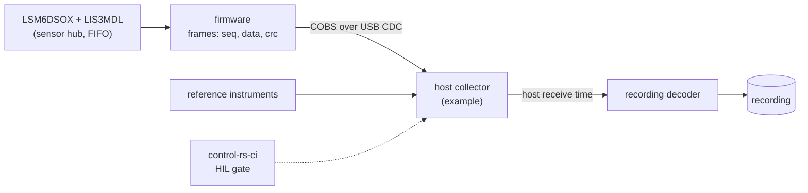

# HIL Collection (hil-collection)

---

### 1. Introduction

HIL collection turns a sensor on a board into recordings. `control-rs`
provides host-side transport and framing for its test server (Dyse
Industries, 2026a) but no HIL harness for data collection, so this
workspace defines the convention each HIL example follows: firmware on the
target, a collector on the host, the framing between them, the host time
reference, and the `control-rs-ci` gates that run them.

Scenarios:

- **H1 Collect.** A user flashes the reference example, starts the
  collector and gets a recording with provenance.
- **H2 Gate.** On a machine with the board attached, `control-rs-ci` runs
  the HIL gates; elsewhere they are skipped.
- **H3 Port.** A user writes a new example for their board and link by
  following the convention.

---

### 2. Requirements

#### 2.1 Functional Requirements

- **FR-1 — Example convention**: Each HIL example must be a firmware crate
  and a host collector that writes recordings through `recording`.
  Board, link and operating-system code stays in the example (overview
  C-1).
- **FR-2 — Framing**: Samples must travel in byte-stuffed frames whose
  zero byte marks packet boundaries unambiguously (Cheshire and Baker,
  1999), each with a sequence counter and checksum.
- **FR-3 — Host time reference**: The collector must stamp every frame
  with host receive time beside the target timestamp, the input to clock
  and latency identification (Olson, 2010).
- **FR-4 — Reference instrumentation**: The convention must carry
  reference channels (supply current, rate-table position, sync events)
  from external instruments into the same recording.
- **FR-5 — Opt-in gates**: HIL gates must be `default = false` gates that
  run only when named or with `--all` (Dyse Industries, 2026b), skip when
  no board answers, and leave artifacts in `target/ci-artifacts` (Dyse
  Industries, 2026b).
- **FR-6 — Reference example**: The workspace must provide one example
  reading the LSM6DSOX and, through its sensor hub, the LIS3MDL
  (STMicroelectronics, 2024), with FIFO timestamps as target times.

#### 2.2 Non-Functional Requirements

- **NFR-1 — Loss detection**: Every dropped or corrupt frame must be
  detected from the sequence counter or checksum and counted in the
  recording.
- **NFR-2 — Framing overhead**: Framing must add at most one byte in 254
  (Cheshire and Baker, 1999).

#### 2.3 Constraints

- **C-1 — Outside the library**: Firmware crates are outside the
  workspace with their own target; collectors use example-only
  dependencies.
- **C-2 — Gate runner**: Gates run through `control-rs-ci` built from the
  pinned `control-rs` revision (overview C-3).

---

### 3. Technical Overview

Required expertise: embedded firmware, serial protocols and bench
instrumentation.

---

### 4. Architecture

#### 4.1 Frame

| Field | Content |
|:--|:--|
| Sequence | Monotonic counter, wraps (NFR-1) |
| Target time | Sensor FIFO timestamp (STMicroelectronics, 2024) |
| Payload | Raw counts per channel, temperature |
| Checksum | CRC over the unstuffed frame (assumption: a 16-bit CRC suffices at these frame sizes) |

Frames are COBS-encoded and delimited by zero bytes, which keeps the
encoding computationally cheap and the delimiter unambiguous (Cheshire and
Baker, 1999). The decoder in `recording` handles frames split across
reads.

#### 4.2 Time Reference

The collector stamps host receive time when a frame completes. It does
not try to correct latency; `measurement-timing` fits offset and rate from
the low-latency observations, since latency is positive (Olson, 2010).

#### 4.3 Gates

| Gate | Command | Default | Required |
|:--|:--|:--|:--|
| `hil-static` | Collector, `static` run, short duration | `false` | `false` |
| `hil-multi-position` | Collector, guided `multi-position` run | `false` | `false` |
| `hil-acceptance` | Acceptance on the latest held-out recording | `false` | `false` |

A collector exits with a dedicated code when no board answers, which the
gate maps to skipped. Long runs (hours) are not gates; they are started
by hand and their recordings committed outside the repository.

#### 4.4 Layout

| Path | Contents |
|:--|:--|
| `examples/hil/lsm6dsox-lis3mdl/` | Firmware crate, `publish = false`, own `.cargo/config.toml` |
| `examples/collect_lsm6dsox.rs` | Host collector |
| `.cargo/gate.toml` | Gates of §4.3 |

---

### 5. Alternatives

- **control-rs ETS session.** `control-rs-ets-host` owns transport and
  framing for test runs (Dyse Industries, 2026a). Reusing it would avoid a
  second protocol, but its host session API is changing and it targets
  test execution, not continuous streaming. A later revision can move the
  examples onto it.
- **Line-based text over serial.** Easy to debug but larger, slower and
  without loss detection.

---

### 6. Verification & Validation

#### 6.1 Verification

| Condition | Requirement | Method | Target | Criterion |
|:--|:--|:--|:--|:--|
| VC-1.1 | FR-1 | `gate` | `hil-static` | The reference example produces a recording that `recording` accepts for run type `static`; FR-1 holds iff this condition holds |
| VC-2.1 | FR-2 | `libtest` | `control_rs_sensors::collect::decode::tests::cobs_round_trip` | Generated frames containing zero bytes round-trip through encode and decode; FR-2 holds iff this condition holds |
| VC-3.1 | FR-3 | `gate` | `hil-static` | Every row of the gate's recording has a host time not earlier than the previous row's; FR-3 holds iff this condition holds |
| VC-4.1 | FR-4 | `libtest` | `control_rs_sensors::collect::decode::tests::reference_channel_merge` | Reference samples merged by host time land on the nearest sample row; FR-4 holds iff this condition holds |
| VC-5.1 | FR-5 | `gate` | `fetch` | `.cargo/gate.toml` loads with every HIL gate `default = false` and `required = false`; FR-5 holds iff this condition holds |
| VC-6.1 | FR-6 | `gate` | `hil-multi-position` | The reference example records accelerometer, gyroscope and magnetometer channels in one recording; FR-6 holds iff this condition holds |
| VC-7.1 | NFR-1 | `libtest` | `control_rs_sensors::collect::decode::tests::loss_counted` | Dropped and corrupted frames in a generated stream are counted exactly; NFR-1 holds iff this condition holds |
| VC-8.1 | NFR-2 | `libtest` | `control_rs_sensors::collect::decode::tests::cobs_overhead` | Encoded length is at most $\lceil n/254 \rceil + 1$ bytes over the input length for generated frames; NFR-2 holds iff this condition holds |
| VC-9.1 | C-1 | `gate` | `deps` | The library's dependency tree at depth 1 is `control-rs` only; C-1 holds iff this condition holds |
| VC-10.1 | C-2 | `gate` | `fetch` | The runner resolves `control-rs` at the pinned revision; C-2 holds iff this condition holds |

#### 6.3 Limits

- HIL gates do not run in hosted CI; their conditions stay unverified
  there.

---

### 8. Risks & Open Questions

- **Host receive jitter.** USB CDC receive-time jitter on common operating
  systems is unmeasured.
- **Checksum width.** The 16-bit CRC is an assumption.
- **COBS citation.** Volume and pages of Cheshire and Baker (1999) are
  missing from the research file.

---

### 9. Development Plan

| Phase | Delivers | Requirements | Effort | Status |
|:--|:--|:--|:--|:--|
| 1. Protocol | Frame, COBS, loss counting | FR-2, NFR-1, NFR-2 | 2 days | Planned |
| 2. Reference example | Firmware, collector, reference channels | FR-1, FR-3, FR-4, FR-6, C-1 | 4 days | Planned |
| 3. Gates | HIL gates in `.cargo/gate.toml` | FR-5, C-2 | 1 day | Planned |

---

### 10. Revision History

| Revision | Date | Author | Description |
|:--|:--|:--|:--|
| 1.0 | October 30, 2026 | @MitchellDScott, Claude | Initial design: FR-1 to FR-6, NFR-1, NFR-2, C-1, C-2. |

---

## References

[1] Dyse Industries, "control-rs workspace manifests (Cargo.toml) at rev
    9f13052," in *Dyse-Industries/control-rs*. [Online]. Available:
    https://github.com/Dyse-Industries/control-rs/tree/9f13052a986512077ad259e5f7fb98e1c1bc0c55.
    Accessed: Oct. 30, 2026.

[2] S. Cheshire and M. Baker, "Consistent overhead byte stuffing,"
    *IEEE/ACM Trans. Netw.*, 1999.

[3] E. Olson, "A passive solution to the sensor synchronization problem,"
    University of Michigan APRIL Laboratory. [Online]. Available:
    https://april.eecs.umich.edu/pdfs/olson2010.pdf. Accessed: Oct. 30,
    2026.

[4] Dyse Industries, "control-rs-ci README," in *Dyse-Industries/control-rs*.
    [Online]. Available:
    https://github.com/Dyse-Industries/control-rs/blob/main/control-rs-ci/README.md.
    Accessed: Oct. 30, 2026.

[5] STMicroelectronics, "LSM6DSOX: iNEMO inertial module with Machine
    Learning Core, Finite State Machine and advanced Digital Functions,"
    STMicroelectronics, Datasheet DS12814 Rev 4, 2024.
