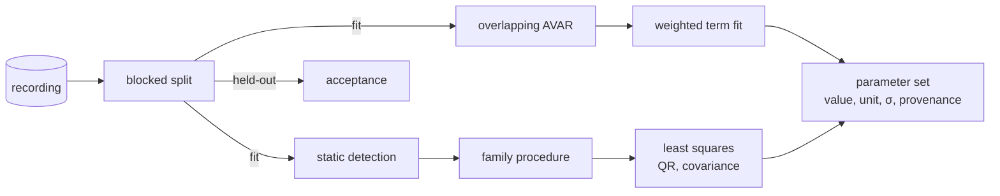

# Identification (identification)

---

### 1. Introduction

Identification is the shared estimation machinery behind every family and
timing procedure: Allan variance and its term fit, least squares with
covariance, static-interval detection and the fit/held-out split. It owns
the parameter set artifact of `sensor-model-pipeline-design.md` §4.2:
values, units, uncertainty and provenance (overview FR-3, FR-4). Family
documents own their procedures; this document owns the tools those
procedures call.

Scenarios:

- **I1 Noise.** A family passes a corrected static recording and the terms
  it models; identification returns the terms with intervals.
- **I2 Calibration.** A family passes residual and Jacobian functions;
  identification returns the estimate, its covariance and conditioning.
- **I3 Split.** Acceptance asks for the held-out part of a recording that
  identification never saw.

---

### 2. Requirements

#### 2.1 Functional Requirements

- **FR-1 — Overlapping Allan variance**: The Allan variance must be the
  fully overlapping estimator at log-spaced cluster times, which improves
  confidence over non-overlapping clusters (Riley, 2008).
- **FR-2 — Weighted term fit**: Noise terms must be fitted to the Allan
  variance points weighted by the variance and covariance of those points
  (Vaccaro and Zaki, 2012), over only the terms the caller models, since
  the Allan variance does not determine a unique noise spectrum (Hou,
  2004).
- **FR-3 — Parameter uncertainty**: Every estimate must carry an
  uncertainty: chi-squared intervals for Allan quantities (Riley, 2008) and
  the estimate covariance for least squares.
- **FR-4 — Least squares service**: Identification must solve linear and
  nonlinear least-squares problems posed by families, returning estimate,
  covariance and condition number.
- **FR-5 — Static-interval detection**: Identification must find static
  intervals in a recording automatically, without tuning (Tedaldi et al.,
  2014).
- **FR-6 — Blocked held-out split**: Held-out data must be whole trailing
  blocks of a recording or whole recordings, never interleaved samples,
  because temporal dependence invalidates sample-level cross-validation
  (Bergmeir and Benítez, 2012).
- **FR-7 — Parameter set record**: Results must be written as a parameter
  set naming, per parameter, its value, unit, uncertainty and provenance:
  recording identifiers and index ranges, run type, procedure and
  `control-rs` revision.

#### 2.2 Non-Functional Requirements

- **NFR-1 — Long recordings**: Allan computation over $10^6$ to $10^7$
  samples must finish in time linear in length per cluster time, using
  cumulative sums.

#### 2.3 Constraints

- **C-1 — Host only**: Identification runs under `std` and is not built
  for targets.
- **C-2 — Linear algebra from control-rs**: Factorizations come from
  `control-rs` (QR, Cholesky); SVD is not assumed.

---

### 3. Technical Overview

Required expertise: estimation theory and time-frequency statistics.

---

### 4. Architecture

#### 4.1 Allan Variance

Cumulative sums give each cluster average in constant time, so each
cluster time costs one pass (NFR-1). Cluster times are log-spaced up to a
tenth of the record length.

#### 4.2 Term Fit

The model $\sigma^2(\tau) = \sum_j a_j\,\phi_j(\tau)$ is linear in the term
coefficients $a_j$ (white noise $\tau^{-1}$, bias instability $\tau^0$,
random walk $\tau^{1}$, and, for timing, the clock terms). The fit is the
best linear unbiased estimator using the variance and covariance of the
Allan points (Vaccaro and Zaki, 2012), solved by QR. The caller names the
terms (FR-2).

#### 4.3 Least Squares

Linear problems use QR. Nonlinear problems use Gauss-Newton with QR steps
and a step-halving line search; covariance is the scaled inverse of the
normal matrix at the solution, and the condition number is reported for
the families' conditioning checks.

#### 4.4 Static Detection

A sliding-window variance of the accelerometer norm against a threshold
set from the static run's own noise level marks static intervals
(assumption: this reproduces the cited method's tuning-free detection,
which the research file does not specify).

#### 4.5 Split and Parameter Set

By default the last 25 % of each recording is held out (Bergmeir and
Benítez, 2012); a whole recording can be held out instead. The parameter
set is the record `model-export` writes and `model-core` reads values
from.

#### 4.6 Module Layout

| Path | Contents |
|:--|:--|
| `src/fit/allan.rs` | Overlapping AVAR, term fit |
| `src/fit/lsq.rs` | Linear and Gauss-Newton least squares |
| `src/fit/static_detect.rs` | Static-interval detection |
| `src/fit/params.rs` | Parameter set, split |

---

### 5. Alternatives

- **Graphical slope reading.** Reading terms at fixed cluster times is the
  common procedure, but it uses a few points and ignores their correlation;
  the weighted fit uses all of them (Vaccaro and Zaki, 2012).
- **Random sample split.** Interleaving fit and held-out samples leaks
  temporal dependence into the held-out set (Bergmeir and Benítez, 2012).
- **Blocked cross-validation.** Uses all data (Bergmeir and Benítez, 2012)
  but multiplies identification runs; it is a later option, not the
  default.

---

### 6. Verification & Validation

#### 6.1 Verification

| Condition | Requirement | Method | Target | Criterion |
|:--|:--|:--|:--|:--|
| VC-1.1 | FR-1 | `libtest` | `control_rs_sensors::fit::allan::tests::white_noise_slope` | The Allan variance of synthesized white noise follows $\sigma^2/\tau$ within §6.2; FR-1 holds iff this condition holds |
| VC-2.1 | FR-2 | `libtest` | `control_rs_sensors::fit::allan::tests::three_term_recovery` | White-noise, instability and random-walk coefficients of a manufactured run are recovered within §6.2; FR-2 holds iff this condition holds |
| VC-3.1 | FR-3 | `libtest` | `control_rs_sensors::fit::allan::tests::interval_coverage` | Over 200 seeds, each 95 % interval contains the true value in at least 180 runs; FR-3 holds iff this condition holds |
| VC-4.1 | FR-4 | `libtest` | `control_rs_sensors::fit::lsq::tests::nonlinear_recovery` | A manufactured nonlinear problem is solved within 3 standard deviations of its covariance; FR-4 holds iff all conditions hold |
| VC-4.2 | FR-4 | `libtest` | `control_rs_sensors::fit::lsq::tests::condition_reported` | A rank-deficient problem reports a condition number above the threshold |
| VC-5.1 | FR-5 | `libtest` | `control_rs_sensors::fit::static_detect::tests::intervals_found` | Detected intervals match generated intervals within one sample at each edge; FR-5 holds iff this condition holds |
| VC-6.1 | FR-6 | `libtest` | `control_rs_sensors::fit::params::tests::blocked_split` | Fit and held-out sets are disjoint contiguous ranges; FR-6 holds iff this condition holds |
| VC-7.1 | FR-7 | `libtest` | `control_rs_sensors::fit::params::tests::record_complete` | Every parameter in a written set has value, unit, uncertainty and provenance with recording ranges; FR-7 holds iff this condition holds |
| VC-8.1 | NFR-1 | `libtest` | `control_rs_sensors::fit::allan::tests::linear_time` | Doubling record length at most doubles time per cluster time, within 20 %; NFR-1 holds iff this condition holds |
| VC-9.1 | C-1 | `gate` | `no-std` | The `no-std` build excludes `src/fit`; C-1 holds iff this condition holds |
| VC-10.1 | C-2 | `gate` | `deps` | The dependency tree at depth 1 is `control-rs` only; C-2 holds iff this condition holds |

Coverage: 90 % line coverage of `control_rs_sensors::fit::{allan, lsq,
static_detect, params}`, measured with `cargo tarpaulin`.

#### 6.2 Acceptance

| Claim | Oracle | Measure | Bound |
|:--|:--|:--|:--|
| White-noise slope, term recovery (VC-1.1, VC-2.1) | Manufactured solution | Relative error | Inside the 95 % chi-squared interval for the cluster time (Riley, 2008) |

#### 6.3 Limits

- Interval coverage is checked on synthesized data with the modeled terms
  only; unmodeled terms in real data bias the fit.

---

### 8. Risks & Open Questions

- **Allan covariance formulas.** Only the abstract of Vaccaro and Zaki
  (2012) is in the research file; the covariance expressions must be
  taken from the paper body.
- **Static detection.** §4.4 is an assumption.
- **Held-out fraction.** 25 % is a default chosen here, not a cited value.

---

### 9. Development Plan

| Phase | Delivers | Requirements | Effort | Status |
|:--|:--|:--|:--|:--|
| 1. Allan | Overlapping AVAR, weighted fit, intervals | FR-1, FR-2, FR-3, NFR-1 | 3 days | Planned |
| 2. Least squares and detection | Gauss-Newton, conditioning, static detection | FR-4, FR-5, C-2 | 3 days | Planned |
| 3. Parameter set | Split, record | FR-6, FR-7, C-1 | 1 day | Planned |

---

### 10. Revision History

| Revision | Date | Author | Description |
|:--|:--|:--|:--|
| 1.0 | October 30, 2026 | @MitchellDScott, Claude | Initial design: FR-1 to FR-7, NFR-1, C-1, C-2. |

---

## References

[1] W. J. Riley, "Handbook of frequency stability analysis," National
    Institute of Standards and Technology, Boulder, CO, USA, NIST Special
    Publication 1065, 2008.

[2] R. J. Vaccaro and A. S. Zaki, "Statistical modeling of rate gyros,"
    *IEEE Trans. Instrum. Meas.*, vol. 61, no. 3, pp. 673–684, 2012,
    doi: 10.1109/TIM.2011.2171609.

[3] H. Hou, "Modeling inertial sensors errors using Allan variance,"
    University of Calgary, Dept. of Geomatics Engineering, Calgary, AB,
    Canada, UCGE Rep. no. 20201, 2004.

[4] D. Tedaldi, A. Pretto, and E. Menegatti, "imu_tk README," in
    *Kyle-ak/imu_tk*, implementing "A robust and easy to implement method
    for IMU calibration without external equipments," Proc. IEEE ICRA,
    Hong Kong, China, 2014, pp. 3042–3049. [Online]. Available:
    https://github.com/Kyle-ak/imu_tk. Accessed: Oct. 30, 2026.

[5] C. Bergmeir and J. M. Benítez, "On the use of cross-validation for time
    series predictor evaluation," *Inf. Sci.*, vol. 191, pp. 192–213, 2012,
    doi: 10.1016/j.ins.2011.12.028.
