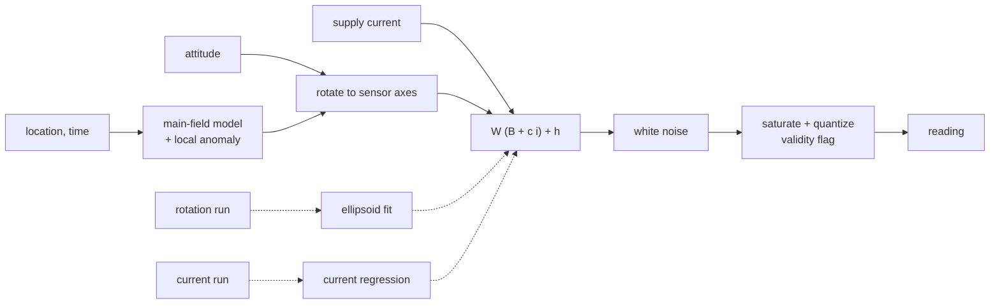

# Magnetometer Model (magnetometer-model)


---

### 1. Introduction

The magnetometer family models a 3-axis magnetometer installed on a
vehicle: what it reports for the local field, the hard- and soft-iron
distortion of its installation and the interference of the vehicle's
supply current, and how each term is identified from bench recordings. It
is a timeless family of `sensor-model-pipeline-design.md`; timing belongs
to `measurement-timing-design.md`.

The reference part is the LIS3MDL, read through the LSM6DSOX sensor hub
(STMicroelectronics, 2024). Its datasheet values are priors and test
fixtures only.

Scenarios:

- **M1 Characterize an installation.** A user rotates the assembled
  vehicle or board through many orientations and identifies hard and soft
  iron, then varies supply current at a fixed attitude and identifies the
  current interference.
- **M2 Simulate.** A simulation passes attitude, location, time and supply
  current and receives the reading the installed part would produce.

---

### 2. Requirements

#### 2.1 Functional Requirements

- **FR-1 — Installation distortion**: The model must apply soft-iron
  distortion (scale, non-orthogonality and misalignment) and hard-iron
  offset to the true field (Liu et al., 2014). Ferromagnetic material near
  the sensor induces field and magnetized material adds a constant offset
  (Liu et al., 2014).
- **FR-2 — Supply-current interference**: The model must add a field
  linear in the vehicle's supply current. Interference correlates with
  supply current and depends on source current, wire shape and distance
  (Chen et al., 2023).
- **FR-3 — Noise, range and resolution**: The model must apply white noise,
  saturate at the configured full scale and quantize to its sensitivity
  (STMicroelectronics, 2017). Noise depends on the operating mode
  (STMicroelectronics, 2014).
- **FR-4 — Reference field**: Truth must be the geomagnetic field at the
  vehicle's location and time from the main-field model, rotated into
  sensor axes (NOAA NCEI, 2026), plus an optional user-supplied local
  anomaly, since the model represents only the main field (NOAA NCEI,
  2026).
- **FR-5 — Ellipsoid calibration**: Hard and soft iron must be identified
  from a rotation recording, whose distorted readings lie on an ellipsoid
  rather than a sphere (Liu et al., 2014).
- **FR-6 — Interference identification**: The current coefficient must be
  identified from a recording that varies supply current at fixed attitude
  (Chen et al., 2023).
- **FR-7 — Raw readings**: Identification must use readings with the
  part's on-chip offset compensation disabled or recorded, because the
  offset register is subtracted from the output (STMicroelectronics, 2014).
- **FR-8 — Disturbance validity**: A sample whose true field exceeds the
  part's magnetic disturbance limit must be marked invalid, because the
  zero-gauss offset degrades above it (STMicroelectronics, 2017).

#### 2.2 Non-Functional Requirements

- **NFR-1 — Calibration coverage**: Calibration must report how much of the
  sphere the rotation run covered and refuse soft-iron estimates the
  coverage does not constrain.

#### 2.3 Constraints

- **C-1 — Main-field validity**: A simulation date outside the loaded
  main-field model's validity period is a configuration error (NOAA NCEI,
  2026).
- **C-2 — Linear interference only**: Interference is linear in one supply
  current; multiple sources and non-linear coupling are out of scope.

---

### 3. Technical Overview



Required expertise: geomagnetism, ellipsoid fitting and least squares.

---

### 4. Architecture

#### 4.1 Error Model

For true field $B$ in sensor axes and supply current $i$:

```latex
y = Q\Big(\mathrm{sat}\big(W\,(B + c\,i) + h + n_k\big)\Big)
```

- $W$: soft-iron matrix (scale, non-orthogonality, misalignment), $h$:
  hard-iron offset (Liu et al., 2014).
- $c$: current interference vector (Chen et al., 2023). It enters before
  $W$ on the assumption that the interfering field is distorted by the same
  nearby material as the geomagnetic field.
- $n_k$: white noise with the operating mode's intensity
  (STMicroelectronics, 2014).
- $\mathrm{sat}$, $Q$ from the configured full scale and its sensitivity
  (STMicroelectronics, 2017); the valid flag is cleared when $\lVert B
  \rVert$ exceeds the disturbance limit (FR-8).

Temperature dependence is not modeled: the reference part compensates it
on chip (STMicroelectronics, 2014).

#### 4.2 Run Types

| Run type | Procedure | Identifies |
|:--|:--|:--|
| `rotation` | Assembled vehicle rotated through as many orientations as possible, away from external sources | $W$, $h$ |
| `current-sweep` | Fixed attitude, supply current stepped across its operating range | $c$ |
| `static` | Stationary | White-noise intensity |

Each recording names the operating mode, full scale and on-chip offset
register values (FR-7).

#### 4.3 Calibration

1. A linear least-squares quadric fit to the rotation run gives the
   ellipsoid (Liu et al., 2014), using QR from `control-rs`.
2. Its center is $h$; a Cholesky factor of its shape matrix, scaled so the
   corrected readings have the local main-field magnitude (NOAA NCEI, 2026),
   is $W^{-1}$.
3. NFR-1: orientation coverage is the fraction of sphere cells visited by
   corrected readings; below a threshold the fit returns hard iron only.
4. With $W$ and $h$ known, $c$ is the least-squares slope of corrected
   field against supply current in the `current-sweep` run (Chen et al.,
   2023).

The static run goes to `identification` for the noise intensity.

#### 4.4 Parameter Set and Reference Part

The parameter set holds $W$, $h$, $c$, noise intensity, operating mode, full
scale and disturbance limit with unit, uncertainty and provenance. LIS3MDL
values (±4 to ±16 gauss full scale, 3.2 to 4.1 mgauss RMS noise in
ultra-high-performance mode, 50 gauss disturbance limit
(STMicroelectronics, 2017)) appear only in tests and examples.

#### 4.5 Module Layout

| Path | Contents | Build |
|:--|:--|:--|
| `src/sim/magnetometer.rs` | Error model, parameter set, validity | `no_std` |
| `src/fit/magnetometer.rs` | Ellipsoid fit, coverage, current regression | `std` |

The main-field model evaluation is a dependency-free module in
`src/sim/` (overview C-1); its coefficient file is user-supplied.

---

### 5. Alternatives

- **On-chip offset compensation.** The part can subtract a hard-iron
  offset itself (STMicroelectronics, 2014), but that hides the raw reading
  the model is identified from and does nothing for soft iron.
- **Hard-iron-only calibration.** Fitting a sphere center is robust with
  little rotation, but leaves soft-iron distortion in the model. It
  remains the fallback when coverage is insufficient (NFR-1).
- **Constant field instead of a main-field model.** Simple for a bench, but
  wrong for any mission that moves or spans a long period. A user-supplied
  constant remains available as the local anomaly with zero main field.

---

### 6. Verification & Validation

#### 6.1 Verification

| Condition | Requirement | Method | Target | Criterion |
|:--|:--|:--|:--|:--|
| VC-1.1 | FR-1 | `libtest` | `control_rs_sensors::sim::magnetometer::tests::distortion_terms` | With noise and current off, output equals $W B + h$ quantized for generated $B$; FR-1 holds iff this condition holds |
| VC-2.1 | FR-2 | `libtest` | `control_rs_sensors::sim::magnetometer::tests::current_interference` | A current step of $\Delta i$ changes output by $W c \Delta i$ with other terms fixed; FR-2 holds iff this condition holds |
| VC-3.1 | FR-3 | `libtest` | `control_rs_sensors::sim::magnetometer::tests::noise_range_resolution` | Output sample variance matches the configured intensity within §6.2, never exceeds full scale and is a multiple of the sensitivity; FR-3 holds iff this condition holds |
| VC-4.1 | FR-4 | `libtest` | `control_rs_sensors::sim::magnetometer::tests::reference_field` | Main-field evaluation at reference points matches the model's published test values within §6.2, and the anomaly adds exactly; FR-4 holds iff this condition holds |
| VC-5.1 | FR-5 | `libtest` | `control_rs_sensors::fit::magnetometer::tests::ellipsoid_recovery` | $W$ and $h$ recovered from a synthesized full-coverage rotation run meet §6.2; FR-5 holds iff this condition holds |
| VC-6.1 | FR-6 | `libtest` | `control_rs_sensors::fit::magnetometer::tests::current_recovery` | $c$ recovered from a synthesized current sweep meets §6.2; FR-6 holds iff this condition holds |
| VC-7.1 | FR-7 | `libtest` | `control_rs_sensors::fit::magnetometer::tests::offset_register_required` | A recording without the offset register values returns an error; FR-7 holds iff this condition holds |
| VC-8.1 | FR-8 | `libtest` | `control_rs_sensors::sim::magnetometer::tests::disturbance_invalid` | A field above the disturbance limit yields an invalid sample and one below it a valid sample; FR-8 holds iff this condition holds |
| VC-9.1 | NFR-1 | `libtest` | `control_rs_sensors::fit::magnetometer::tests::low_coverage_hard_iron_only` | A run covering one great circle returns hard iron only and reports its coverage; NFR-1 holds iff this condition holds |
| VC-10.1 | C-1 | `libtest` | `control_rs_sensors::sim::magnetometer::tests::model_validity` | A date outside the loaded model's validity returns a configuration error; C-1 holds iff this condition holds |
| VC-11.1 | C-2 | `libtest` | `control_rs_sensors::sim::magnetometer::tests::single_current_input` | The model accepts exactly one supply-current input; C-2 holds iff this condition holds |

Coverage: 90 % line coverage of `sim::magnetometer` and
`fit::magnetometer`, measured with `cargo tarpaulin`.

#### 6.2 Acceptance

| Claim | Oracle | Measure | Bound |
|:--|:--|:--|:--|
| Noise variance (VC-3.1) | Manufactured solution | Relative error of sample variance | Inside the 99 % chi-squared interval for the sample count (Riley, 2008) |
| Main-field evaluation (VC-4.1) | Published test values of the loaded model (golden values, with model version) | Absolute error per component | To be taken from the model's documented test tolerance |
| Ellipsoid and current recovery (VC-5.1, VC-6.1) | Manufactured solution with known $W$, $h$, $c$ | Absolute error per parameter | Within 3 standard deviations of the least-squares covariance |

#### 6.3 Limits

- Real-part fidelity rests on acceptance runs, not on these tests.
- Local anomalies and installation fields that change with attitude are
  not identified.

---

### 8. Risks & Open Questions

- **Magnetometer-to-IMU alignment.** The rotation of the magnetometer axes
  relative to the inertial axes is not identified here; heading accuracy
  depends on it.
- **Interference placement.** Whether $c\,i$ belongs before or after $W$
  (§4.1) is an assumption.
- **Main-field test values.** The bound of VC-4.1 needs the main-field
  model's published test values, which the research file does not hold.
- **Coverage threshold.** The NFR-1 threshold is not yet chosen.
- **Non-linearity.** The reference part's ±0.12 %FS non-linearity
  (STMicroelectronics, 2017) is not modeled.

---

### 9. Development Plan

| Phase | Delivers | Requirements | Effort | Status |
|:--|:--|:--|:--|:--|
| 1. Model | Error model, validity, main-field evaluation | FR-1, FR-2, FR-3, FR-4, FR-8, C-1, C-2 | 4 days | Planned |
| 2. Calibration | Ellipsoid fit, coverage, current regression, raw-reading check | FR-5, FR-6, FR-7, NFR-1 | 3 days | Planned |

---

### 10. Revision History

| Revision | Date | Author | Description |
|:--|:--|:--|:--|
| 1.0 | October 30, 2026 | @MitchellDScott, Claude | Initial design: FR-1 to FR-8, NFR-1, C-1, C-2. |

---

## References

[1] STMicroelectronics, "LSM6DSOX: iNEMO inertial module with Machine
    Learning Core, Finite State Machine and advanced Digital Functions,"
    STMicroelectronics, Datasheet DS12814 Rev 4, 2024. [Online]. Available:
    https://www.st.com/resource/en/datasheet/lsm6dsox.pdf. Accessed:
    Oct. 30, 2026.

[2] Y. X. Liu, X. S. Li, X. J. Zhang, and Y. B. Feng, "Novel calibration
    algorithm for a three-axis strapdown magnetometer," *Sensors*, vol. 14,
    no. 5, pp. 8485–8504, 2014, doi: 10.3390/s140508485.

[3] B. Chen, L. Huang, K. Zhang, J. Hu, and W. Zhu, "Magnetic interference
    analysis and compensation method of airborne electronic equipment in an
    unmanned aerial vehicle," *Appl. Sci.*, vol. 13, no. 13, art. 7455,
    2023, doi: 10.3390/app13137455.

[4] STMicroelectronics, "LIS3MDL: Digital output magnetic sensor:
    ultralow-power, high-performance 3-axis magnetometer,"
    STMicroelectronics, Datasheet DocID024204 Rev 6, 2017. [Online].
    Available: https://www.espruino.com/datasheets/LIS3MDL.pdf. Accessed:
    Oct. 30, 2026.

[5] STMicroelectronics, "LIS3MDL: three-axis digital output magnetometer,"
    STMicroelectronics, Appl. Note AN4602 (DocID027014 Rev 1), Dec. 2014.
    [Online]. Available: https://pololu.com/file/0J1090/LIS3MDL-AN4602.pdf.
    Accessed: Oct. 30, 2026.

[6] NOAA National Centers for Environmental Information, "World Magnetic
    Model (WMM)," *NCEI products*. [Online]. Available:
    https://ncei.noaa.gov/products/world-magnetic-model. Accessed: Oct. 30,
    2026.

[7] W. J. Riley, "Handbook of frequency stability analysis," National
    Institute of Standards and Technology, Boulder, CO, USA, NIST Special
    Publication 1065, 2008.
