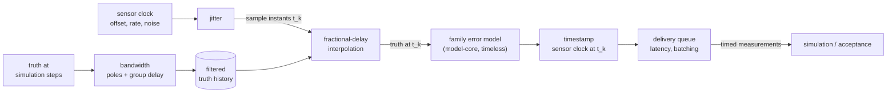

# Measurement Timing (measurement-timing)


---

### 1. Introduction

A family error model says what a sensor reports for one truth sample. It
says nothing about which instant that sample reflects or when the reading
reaches its consumer. A real part filters truth through its own bandwidth,
samples on its own clock and delivers each reading after a delay, and the
timestamp it attaches differs from the instant it sampled (Li and Mourikis,
2014). Unmodeled, that difference reduces estimator accuracy, and a drifting
one can make an estimator fail (Li and Mourikis, 2014).

This document designs the measurement-timing component of
`sensor-model-pipeline-design.md` (FR-9, FR-10). It wraps any family's
timeless error model and turns a simulation's truth stream into timed,
discrete measurements. It also specifies how each timing parameter is
identified from bench recordings (overview FR-3).

Scenarios:

- **T1 Discretize.** A simulation steps its plant at its own interval. The
  wrapped sensor samples on its own drifting, jittering clock, through its
  own bandwidth, and delivers readings when the real part would.
- **T2 Identify.** A user records a part on the bench with a timing
  reference and identifies its clock, jitter, bandwidth and latency.
- **T3 Stress an estimator.** A user replays measurements whose timestamps
  differ from their sampling instants, to test an estimator's temporal
  calibration.

---

### 2. Requirements

#### 2.1 Functional Requirements

- **FR-1 — Sensor clock**: Sample instants must follow a clock model in
  which sensor time is true time plus an offset, a rate error and clock
  noise (Zucca and Tavella, 2005; Van Dierendonck et al., n.d.). A part's
  actual output rate deviates from its configured rate (Borlini, 2020), so a
  nominal-rate clock misplaces every sample after the first.
- **FR-2 — Sample jitter**: Each sample instant must deviate from its clock
  tick by a per-sample jitter term, separate from the clock's rate error.
  Per-device jitter is much smaller than the unit-to-unit rate spread
  (Borlini, 2020), and its effect grows with the signal's slew rate
  (Brannon, 2004).
- **FR-3 — Sensor bandwidth**: Truth must pass through the part's bandwidth
  dynamics before it is sampled. Phase delay depends on the filter's pole
  locations (Looney, 2012), and vendors may not disclose the filters
  (Borlini, 2021), so the dynamics are parameters to identify, not a vendor
  filter to reproduce.
- **FR-4 — Fractional sampling**: A sample instant that falls between
  simulation steps must take its value by fractional-delay interpolation of
  the filtered truth, not from the nearest step (Laakso et al., 1996). The
  delay varies from sample to sample under drift and jitter (MathWorks,
  2026).
- **FR-5 — Timestamp and delivery**: Each measurement must carry its true
  sampling instant, the timestamp the consumer sees and its availability
  time. Latency between sampling and availability is non-negative (Olson,
  2010), and batched delivery releases several samples at once
  (STMicroelectronics, 2024).
- **FR-6 — Timing identification**: Clock offset, rate error and noise,
  jitter, bandwidth, group delay and latency must each be identifiable from
  recordings, with an uncertainty, through procedures this document
  specifies (§4.6).
- **FR-7 — Family independence**: The wrapper must compose with any
  family's error model through the `model-core` contract. The family sees
  one truth value per sample and no time (overview FR-10).

#### 2.2 Non-Functional Requirements

- **NFR-1 — Reproducible timing**: Clock noise, jitter and latency must draw
  from seeded streams separate from each other and from the family's, so
  equal seeds give bit-identical timed measurements (overview NFR-1).
- **NFR-2 — Bounded state**: The wrapper must run in `no_std` without heap
  allocation. Its truth history and delivery queue have capacities fixed at
  compile time (overview NFR-2).

#### 2.3 Constraints

- **C-1 — Causality**: A measurement's availability time is never earlier
  than its sampling instant, and the wrapper never emits a measurement
  before its availability time (Olson, 2010).
- **C-2 — Truth time base**: Simulation time is true time. Every timing
  parameter is expressed in seconds of true time or as a dimensionless rate.

---

### 3. Technical Overview

The wrapper is a chain of stages around the family's error model. Truth
enters at simulation steps; timed measurements leave at availability times.



Identification runs the chain backwards on recordings: clock and jitter from
sample timestamps against a reference, bandwidth and group delay from a
frequency sweep or step, and latency from availability against sampling
times.

Required expertise: time and frequency metrology, digital signal
processing, and embedded Rust.

---

### 4. Architecture

#### 4.1 Times

Every measurement carries three times, all in true time (C-2):

| Time | Symbol | Meaning |
|:--|:--|:--|
| Sampling instant | $t_k$ | True time at which sample $k$ reflects truth; used by acceptance, never by an estimator under test |
| Timestamp | $s_k$ | Sensor clock reading at $t_k$; what the consumer sees (Li and Mourikis, 2014) |
| Availability | $a_k \ge t_k$ | True time at which the consumer receives the sample (C-1) |

The overview's timed-measurement interface names measurement and
availability times only. This design adds the timestamp; §8 records the
overview revision this needs.

#### 4.2 Sensor Clock and Jitter

The clock is a two-state model: offset $\theta$ and rate error $\rho$, with
time itself carried exactly (Van Dierendonck et al., n.d.). Per nominal tick
$T$:

```latex
\theta_k = \theta_{k-1} + \rho_{k-1} T + w_{\theta,k}, \qquad
\rho_k = \rho_{k-1} + w_{\rho,k}
```

$w_\theta$ is white frequency noise and $w_\rho$ random-walk frequency noise,
the two processes a finite-order state model represents; flicker frequency
noise is left out because no finite-order model fits it (Van Dierendonck et
al., n.d.). Sensor time is true time plus $\theta$, so the sensor's tick $k$
falls at

```latex
t_k = kT - \theta_k + j_k, \qquad s_k = kT
```

with white jitter $j_k$ (FR-2). Initial $\theta_0$ and $\rho_0$ are
per-unit parameters: across parts the rate error dominates (Borlini, 2020).

#### 4.3 Bandwidth and Interpolation

Bandwidth is a low-order linear filter (one or two real or complex poles)
followed by a pure group delay $\tau_g$. The poles carry the phase delay
that depends on pole location (Looney, 2012); $\tau_g$ carries decimation
FIR stages, whose delay is half the tap count over the stage's rate
(Looney, 2012). The filter runs at the simulation step on truth and writes
a history buffer.

The value at $t_k - \tau_g$ is interpolated from that history with a
Lagrange fractional-delay filter of order 1 to 3 in Farrow form, which
allows the delay to change every sample (Laakso et al., 1996; MathWorks,
2026). Order 1 is linear interpolation from the two nearest samples
(MathWorks, 2026).

Assumption to verify: the simulation step is fine enough that filtered
truth is band-limited relative to it. The wrapper reports a configuration
error when the step exceeds the bandwidth filter's validity range.

#### 4.4 Error Model and Timestamping

The interpolated truth enters the family's error model once per sample
(FR-7). The error model is output-referred: its noise is identified from
the part's output samples, which already include the filter's shaping, so
it is applied after bandwidth and sampling. The result is stamped with
$s_k$.

#### 4.5 Delivery

Latency $L_k = a_k - t_k$ is a fixed part plus a non-negative random part
(Olson, 2010). Batch delivery holds samples until a batch of $N$ completes
and releases them together, as a FIFO with timestamp batching does
(STMicroelectronics, 2024). The queue capacity is fixed at compile time
from the maximum latency and batch size (NFR-2).

Each simulation step advances true time to $t$ and returns every queued
measurement with $a_k \le t$, in order (C-1).

#### 4.6 Identification

| Parameters | Run type | Method |
|:--|:--|:--|
| $\theta_0$, $\rho_0$ | Long static run with host receive times | Fit of timestamps against host time using the low-latency observations, since latency is positive (Olson, 2010) |
| Clock noise ($w_\theta$, $w_\rho$ intensities) | Same run | Allan variance of the clock residual, mapped to the model's diffusion coefficients (Zucca and Tavella, 2005); shares the `identification` machinery used for sensor noise |
| Jitter $\sigma_j$ | Same run | Residual spread of sample instants after the clock fit (assumption: white jitter is separable from white frequency noise at the shortest averaging time) |
| Poles, $\tau_g$ | Rate-table sweep | Frequency response, the most direct test for a gyroscope (Looney, 2012) |
| Poles, single-pole check | Self-test step | Step response, which needs no motion but cannot separate filter structures with the same time constant (Looney, 2007) |
| Fixed latency, timestamp offset | Synchronized reference event | Constant temporal offset between timestamps and measurement instants (Rehder et al., 2016) |

Run types are registered with `recording`. Reference timing (host receive
time, sync events, rate-table position) comes from `hil-collection`.
Uncertainty follows the overview's FR-4: chi-squared intervals for Allan
terms (Riley, 2008) and fit covariance for the rest.

#### 4.7 Module Layout

| Path | Contents | Build |
|:--|:--|:--|
| `src/timing/clock.rs` | Two-state clock, jitter | `no_std` |
| `src/timing/bandwidth.rs` | Pole filter, group delay | `no_std` |
| `src/timing/interp.rs` | Farrow-form Lagrange interpolation | `no_std` |
| `src/timing/delivery.rs` | Latency, batching, queue | `no_std` |
| `src/timing/mod.rs` | Wrapper composing the stages around a `model-core` error model | `no_std` |
| `src/fit/timing.rs` | Identification procedures of §4.6 | `std` |

---

### 5. Alternatives

- **Whole-step delays.** Rounding each sample instant to the nearest
  simulation step is simple, but it makes timing depend on the step chosen.
  Fractional-delay filters interpolate between samples and support a
  continuously varying delay (Laakso et al., 1996).
- **Reproduce the vendor filter.** The LSM6DSOX filter transfer functions
  are not disclosed (Borlini, 2021); only cutoff tables are published
  (STMicroelectronics, 2024). An identified low-order model with group delay
  fits any part.
- **Full clock noise model.** Adding flicker frequency noise would need a
  high-order approximation, since no finite-order state model fits it (Van
  Dierendonck et al., n.d.). The two-state model is the minimal model that
  carries offset and drift.
- **Input-referred error model.** Applying noise before the bandwidth
  filter matches the physics of some noise sources, but identification
  observes the output, so input-referred parameters would need
  deconvolution.
- **Symmetric latency.** A zero-mean Gaussian latency is convenient, but it
  allows readings to arrive before they are sampled. Latency is
  non-negative (Olson, 2010).

---

### 6. Verification & Validation

#### 6.1 Verification

| Condition | Requirement | Method | Target | Criterion |
|:--|:--|:--|:--|:--|
| VC-1.1 | FR-1 | `libtest` | `control_rs_sensors::timing::clock::tests::constant_rate_error` | With zero noise and rate error $\rho_0$, sample instants equal $kT - \theta_0 - \rho_0 kT$ exactly; FR-1 holds iff all conditions hold |
| VC-1.2 | FR-1 | `libtest` | `control_rs_sensors::timing::clock::tests::allan_of_clock_noise` | The Allan deviation of synthesized offsets has slopes −1/2 and +1/2 in the white- and random-walk-frequency regions within §6.2 |
| VC-2.1 | FR-2 | `libtest` | `control_rs_sensors::timing::clock::tests::jitter_spread` | The spread of $t_k$ about the noise-free clock equals $\sigma_j$ within §6.2; FR-2 holds iff this condition holds |
| VC-3.1 | FR-3 | `libtest` | `control_rs_sensors::timing::bandwidth::tests::single_pole_step` | A single-pole filter's step response matches its closed form within §6.2; FR-3 holds iff all conditions hold |
| VC-3.2 | FR-3 | `libtest` | `control_rs_sensors::timing::bandwidth::tests::group_delay_shift` | A pure group delay shifts a sinusoid by $\tau_g$ within §6.2 |
| VC-4.1 | FR-4 | `libtest` | `control_rs_sensors::timing::interp::tests::sinusoid_fractional_delay` | Interpolated values of a sinusoid at fractional instants meet §6.2 for orders 1 to 3; FR-4 holds iff all conditions hold |
| VC-4.2 | FR-4 | `libtest` | `control_rs_sensors::timing::interp::tests::exact_on_step` | An instant that coincides with a step returns that step's value exactly |
| VC-5.1 | FR-5 | `libtest` | `control_rs_sensors::timing::delivery::tests::batch_release` | Batched samples are released together at the batch's availability time, in sampling order; FR-5 holds iff all conditions hold |
| VC-5.2 | FR-5 | `libtest` | `control_rs_sensors::timing::tests::three_times_present` | Every timed measurement carries $t_k$, $s_k$ and $a_k$, with $s_k$ equal to the sensor clock at $t_k$ |
| VC-6.1 | FR-6 | `libtest` | `control_rs_sensors::fit::timing::tests::clock_recovery` | $\theta_0$, $\rho_0$ and clock noise recovered from a synthesized run with positive latency meet §6.2; FR-6 holds iff all conditions hold |
| VC-6.2 | FR-6 | `libtest` | `control_rs_sensors::fit::timing::tests::bandwidth_recovery` | Poles and $\tau_g$ recovered from a synthesized sweep meet §6.2 |
| VC-6.3 | FR-6 | `libtest` | `control_rs_sensors::fit::timing::tests::latency_recovery` | Fixed latency recovered from synthesized sync events meets §6.2 |
| VC-7.1 | FR-7 | `libtest` | `control_rs_sensors::timing::tests::wraps_any_error_model` | The wrapper composes unchanged with a pass-through error model and a test family, and the error model receives one value per sample; FR-7 holds iff this condition holds |
| VC-8.1 | NFR-1 | `libtest` | `control_rs_sensors::timing::tests::seed_reproducible` | Equal seeds give bit-identical output, and changing the jitter seed leaves clock and latency draws unchanged; NFR-1 holds iff this condition holds |
| VC-9.1 | NFR-2 | `gate` | `no-std` | The library, including `src/timing`, builds for `thumbv7em-none-eabihf` without `alloc`; NFR-2 holds iff this condition holds |
| VC-10.1 | C-1 | `libtest` | `control_rs_sensors::timing::delivery::tests::never_early` | Over generated latencies and steps, no measurement is returned with $a_k$ later than the current time or $a_k < t_k$; C-1 holds iff this condition holds |
| VC-11.1 | C-2 | `libtest` | `control_rs_sensors::timing::tests::step_invariance` | Halving the simulation step leaves $t_k$, $s_k$ and $a_k$ unchanged; C-2 holds iff this condition holds |

Coverage: 90 % line coverage of `control_rs_sensors::timing` and
`control_rs_sensors::fit::timing`, measured with `cargo tarpaulin`.

#### 6.2 Acceptance

| Claim | Oracle | Measure | Bound |
|:--|:--|:--|:--|
| Clock slopes (VC-1.2) and recovery (VC-6.1) | Manufactured solution: synthesize known $\theta_0$, $\rho_0$, noise intensities | Relative error per term | Inside the 95 % chi-squared interval for the run's degrees of freedom (Riley, 2008) |
| Jitter spread (VC-2.1) | Manufactured solution | Relative error of sample variance | Inside the 99 % chi-squared interval for the sample count |
| Step response (VC-3.1) | Closed form $1 - e^{-t/\tau}$ | Absolute error | Discretization error of the filter at the simulation step (analysis, to be derived in phase 1) |
| Group delay (VC-3.2), interpolation (VC-4.1) | Closed-form shifted sinusoid | Absolute error | Lagrange interpolation remainder for the order and step (analysis, to be derived in phase 1) |
| Bandwidth and latency recovery (VC-6.2, VC-6.3) | Manufactured solution | Absolute error | Within 3 standard deviations of the fit covariance |

#### 6.3 Limits

- Recovery tests use synthesized data. Fidelity on a real part rests on
  acceptance runs with a timing reference, which CI does not run.
- Flicker frequency noise is not modeled (§5).
- Measurement drops are not modeled in this revision.

---

### 7. Performance & Resource Considerations

Per simulation step: one filter update of at most two poles and one history
write. Per sample: one clock update, one jitter draw, one Farrow evaluation
of order at most 3, one error-model call and one queue insert. State is the
filter, a history of a few dozen samples and the delivery queue, all with
compile-time capacities (NFR-2).

---

### 8. Risks & Open Questions

- **Overview interface.** The timed measurement needs the timestamp $s_k$
  beside measurement and availability times (§4.1). This requires a minor
  revision of `sensor-model-pipeline-design.md` §4.2.
- **Latency distribution.** The shape of the non-negative random latency on
  the reference link is unknown and needs bench data (FIFO batching and bus
  transfer).
- **Jitter separability.** Separating white jitter from white frequency
  noise in one static run is an assumption (§4.6).
- **Self-test step.** The LSM6DSOX self-test's own rise time is unknown;
  a slow self-test response lowers the apparent bandwidth (Looney, 2007).
- **Filter tables.** The gyroscope LPF1 bandwidth table was not retrieved;
  only LPF2 cutoffs are in the research file (STMicroelectronics, 2024).
- **Bibliographic gaps.** Van Dierendonck et al. has no year in the
  research file, and Olson's year comes from the file name only.
- **Step validity.** The configuration check of §4.3 needs a concrete bound
  between simulation step and filter bandwidth.

---

### 9. Development Plan

| Phase | Delivers | Requirements | Effort | Status |
|:--|:--|:--|:--|:--|
| 1. Clock and sampling | Two-state clock, jitter, Farrow interpolation; bounds of §6.2 derived | FR-1, FR-2, FR-4, NFR-1, NFR-2, C-2 | 4 days | Planned |
| 2. Bandwidth and delivery | Pole filter, group delay, latency, batching, wrapper | FR-3, FR-5, FR-7, C-1 | 4 days | Planned |
| 3. Identification | Clock, jitter, bandwidth and latency procedures and run types; needs `identification` and `hil-collection` | FR-6 | 5 days | Planned |

---

### 10. Revision History

| Revision | Date | Author | Description |
|:--|:--|:--|:--|
| 1.0 | October 30, 2026 | @MitchellDScott, Claude | Initial design: FR-1 to FR-7, NFR-1, NFR-2, C-1, C-2. |

---

## References

[1] M. Li and A. I. Mourikis, "Online temporal calibration for camera-IMU
    systems: Theory and algorithms," *Int. J. Robot. Res.*, 2014.
    [Online]. Available:
    https://intra.ece.ucr.edu/~mourikis/papers/Li2014IJRR_timing.pdf.
    Accessed: Oct. 30, 2026.

[2] C. Zucca and P. Tavella, "The clock model and its relationship with the
    Allan and related variances," *IEEE Trans. Ultrason., Ferroelectr.,
    Freq. Control*, vol. 52, no. 2, pp. 289–296, 2005.

[3] A. J. Van Dierendonck, J. B. McGraw, and R. G. Brown, "Relationship
    between Allan variances and Kalman filter parameters," in *Proc.
    Precise Time and Time Interval (PTTI) Meeting*. [Online]. Available:
    https://ntrs.nasa.gov/api/citations/19850020926/downloads/19850020926.pdf.
    Accessed: Oct. 30, 2026.

[4] E. Borlini, "LSM6DSO(X) actual ODR vs configuration," *ST Community,
    MEMS sensors forum*, Nov. 2020. [Online]. Available:
    https://community.st.com/mems-sensors-48/lsm6dso-x-actual-odr-vs-configuration-34928.
    Accessed: Oct. 30, 2026.

[5] B. Brannon, "Sampled systems and the effects of clock phase noise and
    jitter," Analog Devices, Inc., Norwood, MA, USA, Appl. Note AN-756,
    2004.

[6] M. Looney, "Analyzing frequency response of inertial MEMS in
    stabilization systems," *Analog Dialogue*, vol. 46, no. 3, Jul. 2012.
    [Online]. Available:
    https://www.analog.com/en/resources/analog-dialogue/articles/analyzing-frequency-response-of-inertial-mems.html.
    Accessed: Oct. 30, 2026.

[7] E. Borlini, "What are the transfer functions of LPF1 and LPF2 for
    LSM6DSOX?," *ST Community, MEMS sensors forum*, May 2021. [Online].
    Available:
    https://community.st.com/mems-sensors-48/what-are-the-transfer-functions-of-lpf1-and-lpf2-for-lsm6dsox-25081.
    Accessed: Oct. 30, 2026.

[8] T. I. Laakso, V. Välimäki, M. Karjalainen, and U. K. Laine, "Splitting
    the unit delay: Tools for fractional delay filter design," *IEEE Signal
    Process. Mag.*, vol. 13, no. 1, pp. 30–60, Jan. 1996,
    doi: 10.1109/79.482137.

[9] MathWorks, "Variable Fractional Delay," *DSP System Toolbox
    documentation*. [Online]. Available:
    https://www.mathworks.com/help/dsp/ref/variablefractionaldelay.html.
    Accessed: Oct. 30, 2026.

[10] E. Olson, "A passive solution to the sensor synchronization problem,"
     University of Michigan APRIL Laboratory. [Online]. Available:
     https://april.eecs.umich.edu/pdfs/olson2010.pdf. Accessed: Oct. 30,
     2026.

[11] STMicroelectronics, "LSM6DSOX: iNEMO inertial module with Machine
     Learning Core, Finite State Machine and advanced Digital Functions,"
     STMicroelectronics, Datasheet DS12814 Rev 4, 2024. [Online].
     Available: https://www.st.com/resource/en/datasheet/lsm6dsox.pdf.
     Accessed: Oct. 30, 2026.

[12] M. Looney, "Motionless bandwidth test for MEMS sensors," *Analog
     Dialogue*, vol. 41, Apr. 2007. [Online]. Available:
     https://www.analog.com/en/resources/analog-dialogue/articles/motionless-bandwidth-test-for-mems-sensors.html.
     Accessed: Oct. 30, 2026.

[13] J. Rehder, R. Siegwart, and P. Furgale, "A general approach to
     spatiotemporal calibration in multisensor systems," *IEEE Trans.
     Robot.*, vol. 32, no. 2, pp. 383–398, 2016.

[14] W. J. Riley, "Handbook of frequency stability analysis," National
     Institute of Standards and Technology, Boulder, CO, USA, NIST Special
     Publication 1065, 2008.
