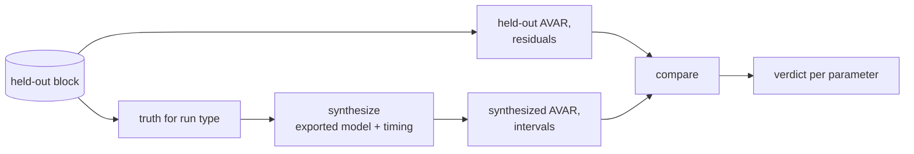

# Model Acceptance (model-acceptance)

---

### 1. Introduction

Acceptance decides whether an exported model reproduces its part. It
synthesizes a run matching a held-out recording, compares the two
statistically and returns a pass or fail per parameter with the evidence
behind it. It owns the verdict artifact of
`sensor-model-pipeline-design.md` §4.2 (overview FR-7).

Scenarios:

- **V1 Accept.** After identification, a user runs acceptance on the
  held-out blocks and gets a verdict per parameter.
- **V2 Gate.** The `hil-acceptance` gate runs acceptance on the latest
  held-out recording and fails on any failed parameter.

---

### 2. Requirements

#### 2.1 Functional Requirements

- **FR-1 — Matched synthesis**: Acceptance must synthesize a run with the
  held-out recording's rate, length, configuration, temperature and run
  type, through the exported model and its timing.
- **FR-2 — Held-out data only**: Comparison must use only blocks the
  identification never saw, reserved from the end of each recording or as
  whole recordings (Bergmeir and Benítez, 2012).
- **FR-3 — Stochastic acceptance**: A noise term must pass when the
  held-out Allan deviation lies inside the synthesized deviation's
  chi-squared interval at each cluster time the term dominates (Riley,
  2008; MathWorks, 2026).
- **FR-4 — Deterministic acceptance**: A calibrated term must pass when
  held-out residuals of its procedure stay within its exported
  uncertainty.
- **FR-5 — Residual distribution**: The distribution of held-out residuals
  must be tested against the model's predicted distribution with a
  goodness-of-fit test whose distribution is fully specified, which holds
  because no parameter is estimated from the held-out data (NIST/SEMATECH,
  n.d.).
- **FR-6 — Evidenced verdict**: The verdict must list, per parameter, pass
  or fail, the statistic, its bound and the cluster times or samples that
  failed.

#### 2.2 Non-Functional Requirements

- **NFR-1 — Reproducible verdict**: The same recording, model and seed
  must give the same verdict.

#### 2.3 Constraints

- **C-1 — No refitting**: Acceptance never adjusts a parameter; a failed
  verdict sends the user back to identification.
- **C-2 — Continuous quantities only**: The distribution test applies to
  continuous residuals only (NIST/SEMATECH, n.d.); quantized outputs are
  tested after removing quantization or by Allan statistics alone.

---

### 3. Technical Overview

Required expertise: statistical hypothesis testing and time-frequency
statistics.

---

### 4. Architecture

#### 4.1 Truth Reconstruction

| Run type | Truth used for synthesis |
|:--|:--|
| `static` | Zero rate, gravity (and Earth rate for gyroscopes) at the recorded location |
| `multi-position` | Orientations from the calibrated accelerometer, gravity |
| `rotation` | Main field at recorded location and date, attitude from the calibration |
| `current-sweep` | Fixed field, recorded supply current |
| timing run types | As defined in `measurement-timing` §4.6 |

#### 4.2 Comparisons

- **Allan.** At each cluster time, the held-out Allan deviation must lie
  inside the synthesized 95 % chi-squared interval (Riley, 2008),
  computed with the `identification` machinery. A term's verdict uses the
  cluster times where it dominates the fitted curve.
- **Residuals.** Calibration residuals on held-out intervals are compared
  with the exported covariance.
- **Distribution.** A Kolmogorov-Smirnov test compares held-out residuals
  with the model's predicted distribution (NIST/SEMATECH, n.d.); it is
  more sensitive near the center than the tails (NIST/SEMATECH, n.d.), so
  Allan comparisons remain the primary check.

#### 4.3 Module Layout

| Path | Contents |
|:--|:--|
| `src/accept/synth.rs` | Truth reconstruction and matched synthesis |
| `src/accept/compare.rs` | Allan, residual and distribution comparisons |
| `src/accept/verdict.rs` | Verdict record |

---

### 5. Alternatives

- **Compare against training data.** Easy but circular: a model that only
  reproduces its fit data is not evidence of fidelity (overview FR-7).
- **Single scalar score.** One number hides which term failed; a verdict
  per parameter points at the procedure to revisit.

---

### 6. Verification & Validation

#### 6.1 Verification

| Condition | Requirement | Method | Target | Criterion |
|:--|:--|:--|:--|:--|
| VC-1.1 | FR-1 | `libtest` | `control_rs_sensors::accept::synth::tests::matched_run_shape` | The synthesized run has the held-out block's rate, length, configuration and run type; FR-1 holds iff this condition holds |
| VC-2.1 | FR-2 | `libtest` | `control_rs_sensors::accept::synth::tests::fit_data_rejected` | A block overlapping the fit range is rejected; FR-2 holds iff this condition holds |
| VC-3.1 | FR-3 | `libtest` | `control_rs_sensors::accept::compare::tests::same_model_passes` | A held-out run synthesized from the exported model passes every noise term in at least 95 % of 100 seeds; FR-3 holds iff all conditions hold |
| VC-3.2 | FR-3 | `libtest` | `control_rs_sensors::accept::compare::tests::doubled_noise_fails` | A held-out run with doubled white-noise density fails the white-noise term |
| VC-4.1 | FR-4 | `libtest` | `control_rs_sensors::accept::compare::tests::biased_scale_fails` | A held-out run with scale shifted by 5 standard deviations fails that scale term; FR-4 holds iff this condition holds |
| VC-5.1 | FR-5 | `libtest` | `control_rs_sensors::accept::compare::tests::ks_against_specified` | The distribution test uses only parameters from the fit set and rejects a uniform residual set; FR-5 holds iff this condition holds |
| VC-6.1 | FR-6 | `libtest` | `control_rs_sensors::accept::verdict::tests::evidence_listed` | Every failed parameter lists its statistic, bound and failing points; FR-6 holds iff this condition holds |
| VC-7.1 | NFR-1 | `libtest` | `control_rs_sensors::accept::verdict::tests::reproducible` | Two runs with equal inputs and seed give equal verdicts; NFR-1 holds iff this condition holds |
| VC-8.1 | C-1 | `libtest` | `control_rs_sensors::accept::verdict::tests::parameters_unchanged` | The model's parameters are byte-identical before and after acceptance; C-1 holds iff this condition holds |
| VC-9.1 | C-2 | `libtest` | `control_rs_sensors::accept::compare::tests::quantized_handled` | Quantized residuals are dequantized before the distribution test; C-2 holds iff this condition holds |

#### 6.3 Limits

- Many parameters tested at once raise the chance of a false failure;
  multiple-comparison control is not yet designed.
- Real-part verdicts come only from HIL gates and hand-run recordings.

---

### 8. Risks & Open Questions

- **Multiple comparisons.** Correcting per-parameter thresholds for the
  number of tests is unresearched.
- **Dominance regions.** Choosing the cluster times where a term dominates
  needs a rule fixed during implementation.

---

### 9. Development Plan

| Phase | Delivers | Requirements | Effort | Status |
|:--|:--|:--|:--|:--|
| 1. Synthesis | Truth reconstruction, matched runs, held-out check | FR-1, FR-2, C-1 | 2 days | Planned |
| 2. Comparisons and verdict | Allan, residual, distribution tests; verdict | FR-3, FR-4, FR-5, FR-6, NFR-1, C-2 | 3 days | Planned |

---

### 10. Revision History

| Revision | Date | Author | Description |
|:--|:--|:--|:--|
| 1.0 | October 30, 2026 | @MitchellDScott, Claude | Initial design: FR-1 to FR-6, NFR-1, C-1, C-2. |

---

## References

[1] C. Bergmeir and J. M. Benítez, "On the use of cross-validation for time
    series predictor evaluation," *Inf. Sci.*, vol. 191, pp. 192–213, 2012,
    doi: 10.1016/j.ins.2011.12.028.

[2] W. J. Riley, "Handbook of frequency stability analysis," National
    Institute of Standards and Technology, Boulder, CO, USA, NIST Special
    Publication 1065, 2008.

[3] MathWorks, "Inertial Sensor Noise Analysis Using Allan Variance,"
    *Navigation Toolbox documentation*. [Online]. Available:
    https://ch.mathworks.com/help/nav/ug/inertial-sensor-noise-analysis-using-allan-variance.html.
    Accessed: Oct. 30, 2026.

[4] NIST/SEMATECH, "1.3.5.16. Kolmogorov-Smirnov goodness-of-fit test,"
    *e-Handbook of Statistical Methods*. [Online]. Available:
    https://itl.nist.gov/div898/handbook/eda/section3/eda35g.htm. Accessed:
    Oct. 30, 2026.
