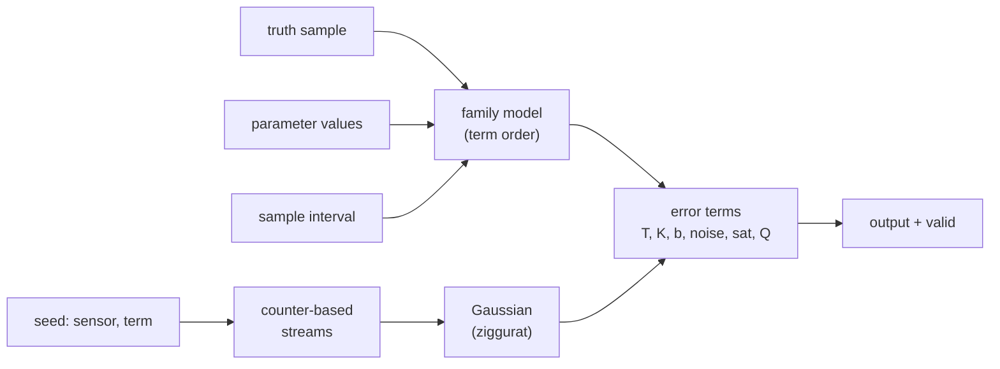

# Model Core (model-core)

---

### 1. Introduction

Model core is the `no_std` foundation every sensor family builds on. It
fixes the sensor model contract of `sensor-model-pipeline-design.md` §4.2,
provides the error terms the families compose, and owns the random sources
that make synthesis reproducible. It knows nothing about time beyond the
sample interval it is handed: clocks, bandwidth and latency belong to
`measurement-timing-design.md`.

Scenarios:

- **K1 Compose a family.** A family document lists its error terms and
  their order; model core supplies each term and the contract they meet.
- **K2 Replay a run.** A simulation reruns a scenario with the same seeds
  and receives the same measurements, bit for bit.
- **K3 Run on target.** The same model compiles for a microcontroller
  without an allocator.

---

### 2. Requirements

#### 2.1 Functional Requirements

- **FR-1 — Timeless contract**: A sensor model must map one truth sample,
  its parameters and the sample interval to one output and a valid flag,
  with no clock or history of call times. Timing wraps the model from
  outside (overview FR-10).
- **FR-2 — Error-term library**: Model core must provide misalignment
  (cross-coupling), scale factor, bias, white noise, bias random walk, bias
  instability, saturation and quantization as composable terms. These are
  the terms a simulation sensor model combines (Gallo, 2021).
- **FR-3 — Interval-correct noise**: White noise and bias random walk must
  be discretized at the interval of each call, with standard deviations
  $\sigma/\sqrt{\Delta t}$ and $\sigma_b\sqrt{\Delta t}$ (ethz-asl, 2016).
- **FR-4 — Keyed random streams**: Every stochastic term must draw from its
  own stream, keyed by sensor and term and indexed by a counter, so a value
  is a function of key and counter alone (Salmon et al., 2011).
- **FR-5 — Gaussian sampling**: Standard normal draws must come from a
  table-driven method without heap allocation (Voss, n.d.).

#### 2.2 Non-Functional Requirements

- **NFR-1 — Bit-identical replay**: Equal seeds, parameters, truth and
  intervals must give bit-identical output, and adding a sensor or term
  must leave every other stream unchanged. Seeds are the only stochastic
  inputs (Gallo, 2021).
- **NFR-2 — Allocation-free, bounded work**: Model core must build without
  `alloc` and do a fixed amount of work per call.

#### 2.3 Constraints

- **C-1 — Float functions through control-rs**: Square root, logarithm and
  exponential come only through `control-rs`, which depends on `libm`
  (Dyse Industries, 2026); this crate adds no direct dependency
  (overview C-1).
- **C-2 — Values only**: Model core consumes parameter values. Units,
  uncertainty and provenance live in the parameter set owned by
  `identification`.

---

### 3. Technical Overview

Required expertise: stochastic processes, random number generation and
`no_std` Rust.

---

### 4. Architecture

#### 4.1 Contract

A family model holds its parameters and term state (bias processes, stream
counters) and exposes one step: truth sample and interval in, output and
valid flag out. The truth type is family-specific (specific force, angular
rate and specific force, field and supply current). Measurement timing
calls the step once per sample instant.

#### 4.2 Error Terms

| Term | Form | State |
|:--|:--|:--|
| Misalignment | Unit-diagonal matrix (Gallo, 2021) | none |
| Scale factor | Diagonal matrix (Gallo, 2021) | none |
| Bias | Constant plus optional linear temperature term | none |
| White noise | $\sigma/\sqrt{\Delta t}$ per call (ethz-asl, 2016) | stream counter |
| Bias random walk | $b_k = b_{k-1} + \sigma_b\sqrt{\Delta t}\,w_k$ (ethz-asl, 2016) | $b_k$, counter |
| Bias instability | Process to be fixed in this document's next revision (§8) | per process |
| Saturation, quantization | Clamp to full scale, round to sensitivity | none |

A family document fixes the order; families share the terms, not a
universal formula.

#### 4.3 Random Sources

Each stream is a counter-based generator: the $n$-th value is a keyed
function of $n$ (Salmon et al., 2011). The key is derived from the user
seed, the sensor identifier and the term identifier. The state is one
counter, which is "little or no memory for state" (Salmon et al., 2011).
The family of generators chosen passes TestU01 BigCrush (Salmon et al.,
2011).

Gaussian draws use the ziggurat method with a 128-step table held as a
`const` (Voss, n.d.). It ran 3.9 times faster than the better of
Box-Muller and the polar method in that comparison (Voss, n.d.).

#### 4.4 Module Layout

| Path | Contents | Build |
|:--|:--|:--|
| `src/sim/contract.rs` | Model step contract, output and valid flag | `no_std` |
| `src/sim/terms.rs` | Error terms of §4.2 | `no_std` |
| `src/sim/random.rs` | Keyed counter-based streams, ziggurat | `no_std` |

---

### 5. Alternatives

- **Sequential generator per simulation.** One shared generator is simple,
  but adding a sensor shifts every later draw, breaking NFR-1. Keyed
  counter-based streams are independent by construction (Salmon et al.,
  2011).
- **Box-Muller.** Needs no table but costs two transcendental calls per
  pair and ran slower in the cited comparison (Voss, n.d.).
- **Unbounded bias random walk.** The cited simulator bounds its random
  walk to a band around the mean (Gallo, 2021). Model core keeps the
  unbounded Kalibr form, which matches the Allan identification, and
  leaves bounding to the bias-instability decision (§8).

---

### 6. Verification & Validation

#### 6.1 Verification

| Condition | Requirement | Method | Target | Criterion |
|:--|:--|:--|:--|:--|
| VC-1.1 | FR-1 | `libtest` | `control_rs_sensors::sim::contract::tests::output_independent_of_call_time` | Two calls with equal truth, parameters, interval and stream counters give equal outputs whatever wall or simulation time separates them; FR-1 holds iff this condition holds |
| VC-2.1 | FR-2 | `libtest` | `control_rs_sensors::sim::terms::tests::deterministic_terms_exact` | Misalignment, scale, bias, saturation and quantization equal their closed forms on generated inputs; FR-2 holds iff all conditions hold |
| VC-2.2 | FR-2 | `libtest` | `control_rs_sensors::sim::terms::tests::stochastic_terms_statistics` | White-noise variance and random-walk increment variance meet §6.2 |
| VC-3.1 | FR-3 | `libtest` | `control_rs_sensors::sim::terms::tests::interval_scaling` | Halving the interval doubles the white-noise variance and halves the random-walk increment variance within §6.2; FR-3 holds iff this condition holds |
| VC-4.1 | FR-4 | `libtest` | `control_rs_sensors::sim::random::tests::value_is_function_of_key_and_counter` | Drawing counter $n$ directly equals the $n$-th sequential draw; FR-4 holds iff this condition holds |
| VC-5.1 | FR-5 | `libtest` | `control_rs_sensors::sim::random::tests::ziggurat_normality` | Mean, variance and tail fraction beyond 3σ of $10^7$ draws meet §6.2; FR-5 holds iff this condition holds |
| VC-6.1 | NFR-1 | `libtest` | `control_rs_sensors::sim::random::tests::adding_stream_leaves_others` | Adding a sensor leaves every existing stream bit-identical; NFR-1 holds iff this condition holds |
| VC-7.1 | NFR-2 | `gate` | `no-std` | `src/sim` builds for `thumbv7em-none-eabihf` without `alloc`; NFR-2 holds iff this condition holds |
| VC-8.1 | C-1 | `gate` | `deps` | The normal dependency tree at depth 1 is `control-rs` only; C-1 holds iff this condition holds |
| VC-9.1 | C-2 | `libtest` | `control_rs_sensors::sim::contract::tests::values_only` | Every family model constructs from plain values without a parameter record; C-2 holds iff this condition holds |

Coverage: 95 % line coverage of `control_rs_sensors::sim::{contract,
terms, random}`, measured with `cargo tarpaulin`.

#### 6.2 Acceptance

| Claim | Oracle | Measure | Bound |
|:--|:--|:--|:--|
| Noise variances (VC-2.2, VC-3.1) | Closed form (ethz-asl, 2016) | Relative error of sample variance | Inside the 99 % chi-squared interval for the sample count (Riley, 2008) |
| Ziggurat normality (VC-5.1) | Standard normal moments | Absolute error | Within 4 standard errors of each statistic for $10^7$ draws |

#### 6.3 Limits

- Statistical quality of the generator rests on its published BigCrush
  results, not on tests here.

---

### 8. Risks & Open Questions

- **Bias instability process.** The research holds no source for a
  discrete Gauss-Markov form; the cited simulator uses a bounded random
  walk (Gallo, 2021). The choice must match what `identification` fits
  from the flat region of the Allan deviation.
- **Float functions.** Whether `control-rs` exposes the `libm` functions
  model core needs is unconfirmed; if not, C-1 needs an exception.
- **Ziggurat source.** Marsaglia and Tsang (2000) is cited only through a
  secondary page.

---

### 9. Development Plan

| Phase | Delivers | Requirements | Effort | Status |
|:--|:--|:--|:--|:--|
| 1. Random sources | Keyed counter-based streams, ziggurat | FR-4, FR-5, NFR-1, C-1 | 2 days | Planned |
| 2. Terms and contract | Error-term library, step contract | FR-1, FR-2, FR-3, NFR-2, C-2 | 2 days | Planned |

---

### 10. Revision History

| Revision | Date | Author | Description |
|:--|:--|:--|:--|
| 1.0 | October 30, 2026 | @MitchellDScott, Claude | Initial design: FR-1 to FR-5, NFR-1, NFR-2, C-1, C-2. |

---

## References

[1] E. Gallo, "Customizable stochastic high fidelity model of the sensors
    and camera onboard a low SWaP fixed wing autonomous aircraft,"
    arXiv:2102.06492, 2021.

[2] ethz-asl, "IMU Noise Model," *kalibr GitHub wiki*. [Online]. Available:
    https://github.com/ethz-asl/kalibr/wiki/IMU-Noise-Model. Accessed:
    Oct. 30, 2026.

[3] J. K. Salmon, M. A. Moraes, R. O. Dror, and D. E. Shaw, "Parallel
    random numbers: As easy as 1, 2, 3," in *Proc. SC11*, Seattle, WA, USA,
    2011.

[4] J. Voss, "The ziggurat method for generating Gaussian random numbers,"
    *seehuhn.de*. [Online]. Available:
    https://www.seehuhn.de/pages/ziggurat. Accessed: Oct. 30, 2026.

[5] Dyse Industries, "control-rs workspace manifests (Cargo.toml) at rev
    9f13052," in *Dyse-Industries/control-rs*. [Online]. Available:
    https://github.com/Dyse-Industries/control-rs/tree/9f13052a986512077ad259e5f7fb98e1c1bc0c55.
    Accessed: Oct. 30, 2026.

[6] W. J. Riley, "Handbook of frequency stability analysis," National
    Institute of Standards and Technology, Boulder, CO, USA, NIST Special
    Publication 1065, 2008.
