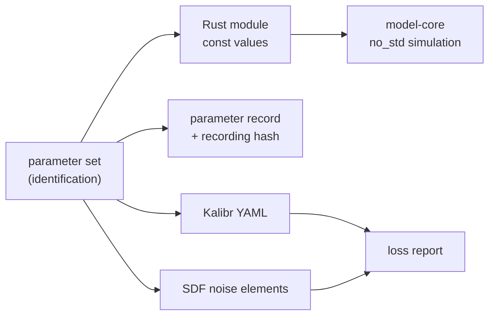

# Model Export (model-export)

---

### 1. Introduction

Model export turns an identified parameter set into the artifacts a user's
simulation and tools consume: `no_std` Rust source, a parameter record,
and interchange files for an estimator configuration and a robotics
simulator. It owns the exported-model artifact of
`sensor-model-pipeline-design.md` §4.2 (overview FR-6).

Scenarios:

- **E1 Compile in.** A mission simulation includes the generated module and
  instantiates the model with no file I/O.
- **E2 Configure an estimator.** A user feeds the noise terms to an
  estimator that reads Kalibr-style YAML.
- **E3 Configure a simulator.** A user gives the terms to a simulator that
  reads SDF noise elements and learns which terms it cannot represent.

---

### 2. Requirements

#### 2.1 Functional Requirements

- **FR-1 — Generated source**: Export must write a Rust module of `const`
  parameter values that compiles in `no_std` and synthesizes exactly what
  the in-memory parameter set synthesizes.
- **FR-2 — Parameter record**: Export must write the parameter set as a
  text record that `identification` reads back unchanged, including a hash
  of the recordings it came from.
- **FR-3 — Kalibr YAML**: Export must write noise densities, random walks
  and update rate in the fields and units of the Kalibr IMU configuration
  (ethz-asl, 2016), the format `allan_variance_ros` also produces
  (Buchanan, 2026).
- **FR-4 — SDF noise elements**: Export must write Gaussian noise
  standard deviation and bias mean and standard deviation as SDF IMU noise
  elements (Open Robotics, n.d.), with the noise standard deviation
  discretized at the declared sensor rate.
- **FR-5 — Loss report**: Each interchange export must list the parameters
  its format cannot represent; Kalibr's model has no scale or misalignment
  terms (ethz-asl, 2016), and SDF draws bias once per run (Open Robotics,
  2026).
- **FR-6 — Deterministic output**: The same parameter set must export to
  byte-identical files.

#### 2.2 Non-Functional Requirements

- **NFR-1 — Readable output**: Generated source and records must be
  diffable text with one parameter per line.

#### 2.3 Constraints

- **C-1 — Hand-written emitters**: Emitters use no serialization crates
  (overview C-1).
- **C-2 — Static-noise caveat**: Interchange files carry identified values
  unchanged and state that static-data noise may need inflating for
  estimators (ethz-asl, 2016); export does not inflate them.

---

### 3. Technical Overview

Required expertise: code generation and estimator and simulator
configuration formats.

---

### 4. Architecture

#### 4.1 Generated Source

One module per exported model: a header comment with the recording hash
and provenance summary, then one `const` per parameter, then one `const`
model constructor built from them. Floats are written with enough digits
to round-trip exactly (FR-1).

#### 4.2 Record

The record is the parameter set's text form: `name = value unit ± sigma
# provenance`, one line per parameter, sorted by name (NFR-1, FR-6).

#### 4.3 Interchange Mapping

| Parameter | Kalibr YAML (ethz-asl, 2016) | SDF IMU noise (Open Robotics, n.d.) |
|:--|:--|:--|
| White-noise density | `*_noise_density` | `stddev` after discretization at the sensor rate |
| Bias random walk | `*_random_walk` | not representable |
| Turn-on bias | not representable | `bias_mean`, `bias_stddev` (drawn once per run (Open Robotics, 2026)) |
| Bias instability, scale, misalignment, temperature, $G$ | not representable | not representable |
| Sample rate | `update_rate` | sensor rate |

Unrepresentable parameters go into the loss report (FR-5).

#### 4.4 Module Layout

| Path | Contents |
|:--|:--|
| `src/export/rust.rs` | Generated source |
| `src/export/record.rs` | Parameter record |
| `src/export/kalibr.rs`, `src/export/sdf.rs` | Interchange emitters and loss reports |

---

### 5. Alternatives

- **Runtime file loading.** Reading parameters at start-up avoids code
  generation but needs file I/O and a parser on target; generated `const`
  values need neither.
- **Log-container attachment.** MCAP attachments can carry calibration data
  alongside recordings (MCAP, n.d.), but adding the container needs a
  dependency (C-1).

---

### 6. Verification & Validation

#### 6.1 Verification

| Condition | Requirement | Method | Target | Criterion |
|:--|:--|:--|:--|:--|
| VC-1.1 | FR-1 | `libtest` | `control_rs_sensors::export::rust::tests::generated_matches_in_memory` | Synthesis from the generated module equals synthesis from the in-memory set bit for bit; FR-1 holds iff all conditions hold |
| VC-1.2 | FR-1 | `gate` | `no-std` | A generated fixture module builds for `thumbv7em-none-eabihf` |
| VC-2.1 | FR-2 | `libtest` | `control_rs_sensors::export::record::tests::record_round_trip` | Every parameter read back equals the exported value, unit, uncertainty and provenance; FR-2 holds iff this condition holds |
| VC-3.1 | FR-3 | `libtest` | `control_rs_sensors::export::kalibr::tests::fields_and_units` | The YAML contains the four noise fields and `update_rate` in Kalibr units; FR-3 holds iff this condition holds |
| VC-4.1 | FR-4 | `libtest` | `control_rs_sensors::export::sdf::tests::noise_elements` | The SDF fragment contains `stddev`, `bias_mean` and `bias_stddev` with the discretized values; FR-4 holds iff this condition holds |
| VC-5.1 | FR-5 | `libtest` | `control_rs_sensors::export::kalibr::tests::loss_report_complete` | Every parameter absent from an interchange file is listed in its loss report; FR-5 holds iff this condition holds |
| VC-6.1 | FR-6 | `libtest` | `control_rs_sensors::export::record::tests::byte_identical` | Two exports of one set are byte-identical; FR-6 holds iff this condition holds |
| VC-7.1 | NFR-1 | `libtest` | `control_rs_sensors::export::record::tests::one_parameter_per_line` | Each parameter occupies exactly one line in source and record; NFR-1 holds iff this condition holds |
| VC-8.1 | C-1 | `gate` | `deps` | The dependency tree at depth 1 is `control-rs` only; C-1 holds iff this condition holds |
| VC-9.1 | C-2 | `libtest` | `control_rs_sensors::export::kalibr::tests::values_not_inflated` | Exported densities equal identified densities exactly; C-2 holds iff this condition holds |

#### 6.3 Limits

- Compatibility with the consuming tools is checked by field names, not by
  running those tools.

---

### 8. Risks & Open Questions

- **SDF version.** Only SDF 1.4 IMU elements are in the research file;
  later versions may add dynamic bias elements.
- **Inflation guidance.** Whether to export an inflated variant for
  estimators is left to users (C-2).

---

### 9. Development Plan

| Phase | Delivers | Requirements | Effort | Status |
|:--|:--|:--|:--|:--|
| 1. Source and record | Generated module, record | FR-1, FR-2, FR-6, NFR-1, C-1 | 2 days | Planned |
| 2. Interchange | Kalibr, SDF, loss reports | FR-3, FR-4, FR-5, C-2 | 2 days | Planned |

---

### 10. Revision History

| Revision | Date | Author | Description |
|:--|:--|:--|:--|
| 1.0 | October 30, 2026 | @MitchellDScott, Claude | Initial design: FR-1 to FR-6, NFR-1, C-1, C-2. |

---

## References

[1] ethz-asl, "IMU Noise Model," *kalibr GitHub wiki*. [Online]. Available:
    https://github.com/ethz-asl/kalibr/wiki/IMU-Noise-Model. Accessed:
    Oct. 30, 2026.

[2] R. Buchanan, *allan_variance_ros*: Allan variance computation for IMU
    rosbags (BSD-3-Clause). Oxford Robotics Institute, DRS Lab. [Online].
    Available: https://github.com/ori-drs/allan_variance_ros. Accessed:
    Oct. 30, 2026.

[3] Open Robotics, "SDFormat 1.4 specification: imu.sdf," *sdformat crate
    source*. [Online]. Available:
    https://docs.rs/crate/sdformat/latest/source/sdformat_spec/1.4/imu.sdf.
    Accessed: Oct. 30, 2026.

[4] Open Robotics, "Tutorial: Sensor noise model," *Gazebo classic
    tutorials*. [Online]. Available:
    https://classic.gazebosim.org/tutorials?tut=sensor_noise. Accessed:
    Oct. 30, 2026.

[5] MCAP, "MCAP format specification," *mcap.dev*. [Online]. Available:
    https://mcap.dev/spec. Accessed: Oct. 30, 2026.
