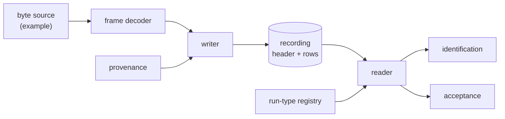

# Recording (recording)


---

### 1. Introduction

A recording is the evidence every identified parameter traces back to
(overview FR-1). This document fixes the recording artifact of
`sensor-model-pipeline-design.md` §4.2: its schema, its provenance, the
registry of run types the families and timing declare, and a plain-text
codec with no dependencies.

Scenarios:

- **R1 Record.** A HIL collector writes samples and provenance as they
  arrive, for runs of several hours.
- **R2 Identify.** Identification reads a recording, checks it has what
  its run type requires and splits it into fit and held-out blocks.
- **R3 Audit.** A reviewer opens a recording in any text tool and sees the
  part, board, settings and conditions it was taken under.

---

### 2. Requirements

#### 2.1 Functional Requirements

- **FR-1 — Provenance header**: Every recording must state part, board,
  firmware revision, `control-rs` revision, sensor configuration, run type,
  date, location and operator notes. A parameter without them cannot be
  traced to its evidence (overview FR-1).
- **FR-2 — Raw samples**: Samples must be stored as raw counts with the
  register settings that shape them, including on-chip offset registers,
  because the part subtracts those from its output (STMicroelectronics,
  2014).
- **FR-3 — Three time columns**: Each sample must carry its index, target
  timestamp and host receive time, the inputs of timing identification
  (`measurement-timing` §4.6).
- **FR-4 — Reference channels**: A recording must carry reference channels
  its run type needs: supply current, rate-table position or sync events.
- **FR-5 — Run-type registry**: Each run type must declare its required
  provenance fields and channels, and a recording that lacks them must be
  rejected when read.
- **FR-6 — Link-agnostic decoding**: Samples must decode from any byte
  source with frames split at arbitrary boundaries (overview FR-2).

#### 2.2 Non-Functional Requirements

- **NFR-1 — Streaming**: Writing and reading must use bounded memory
  regardless of length; a 3-hour run at 104 Hz is about 1.1 M rows.

#### 2.3 Constraints

- **C-1 — Plain text, no dependencies**: The format is UTF-8 text written
  and parsed without external crates (overview C-1).
- **C-2 — Immutable recordings**: Nothing downstream rewrites a recording;
  fit and held-out sets are index ranges into it.

---

### 3. Technical Overview



Required expertise: data formats and embedded data acquisition.

---

### 4. Architecture

#### 4.1 File Layout

```text
# control-rs-sensors recording v1
# part = LSM6DSOX
# board = ...
# run_type = multi-position
# config.accel_fs_g = 4
# ...
index,t_target_us,t_host_us,ax,ay,az,gx,gy,gz,mx,my,mz,temp,ref_current_ma,valid
0,1203,1250,...
```

- Header lines start with `#` and hold `key = value` pairs. Keys are
  namespaced (`config.*`, `location.*`, `register.*`).
- The body is RFC 4180 CSV: a header line with the same format as records
  and the same field count on every line (Shafranovich, 2005). Since CSV
  has no formal specification (Shafranovich, 2005), the reader accepts
  only this subset: no quoting, `\n` line ends, integer fields.
- Raw counts are integers; conversion uses `config.*` and `register.*`
  (FR-2).

#### 4.2 Run-Type Registry

| Run type | Declared by | Required channels | Required provenance |
|:--|:--|:--|:--|
| `static` | families | sensor channels, temperature | location |
| `multi-position` | `accelerometer-model` | accelerometer, gyroscope | location (gravity) |
| `rotation` | `magnetometer-model` | magnetometer | location, date (main field), offset registers |
| `current-sweep` | `magnetometer-model` | magnetometer, `ref_current` | offset registers |
| `clock` | `measurement-timing` | target and host times | link description |
| `sweep` | `measurement-timing` | sensor channels, `ref_position` | rate-table description |
| `step` | `measurement-timing` | sensor channels, self-test flag | — |
| `sync` | `measurement-timing` | `ref_event` | reference source |

#### 4.3 Codec

The writer appends one row per decoded sample and flushes periodically;
the reader yields rows lazily (NFR-1). Frame decoding takes bytes from any
reader and keeps a partial frame across reads (FR-6); the framing itself
is fixed by `hil-collection`.

#### 4.4 Module Layout

| Path | Contents | Build |
|:--|:--|:--|
| `src/collect/schema.rs` | Sample row, provenance keys, run-type registry | `no_std` |
| `src/collect/decode.rs` | Frame decoder over a byte source | `no_std` |
| `src/collect/text.rs` | Writer and reader | `std` |

---

### 5. Alternatives

- **MCAP.** A modular container for timestamped messages in any
  serialization, with key-value metadata records and attachments for
  calibration data (MCAP, n.d.). It fits well but needs a dependency
  (C-1); a converter can live in an example.
- **Binary rows.** Smaller and faster, but not readable in a text tool
  (R3).
- **Converted units.** Storing SI values loses the register context that
  identification needs (FR-2).

---

### 6. Verification & Validation

#### 6.1 Verification

| Condition | Requirement | Method | Target | Criterion |
|:--|:--|:--|:--|:--|
| VC-1.1 | FR-1 | `libtest` | `control_rs_sensors::collect::text::tests::provenance_round_trip` | Every provenance field written is read back equal; FR-1 holds iff all conditions hold |
| VC-1.2 | FR-1 | `libtest` | `control_rs_sensors::collect::text::tests::missing_provenance_rejected` | A recording missing a mandatory field is rejected with the field's name |
| VC-2.1 | FR-2 | `libtest` | `control_rs_sensors::collect::text::tests::raw_counts_exact` | Raw counts and register values round-trip exactly; FR-2 holds iff this condition holds |
| VC-3.1 | FR-3 | `libtest` | `control_rs_sensors::collect::text::tests::time_columns_present` | Every row carries index, target and host times, and indices increase by one; FR-3 holds iff this condition holds |
| VC-4.1 | FR-4 | `libtest` | `control_rs_sensors::collect::text::tests::reference_channels_round_trip` | Reference channels round-trip exactly; FR-4 holds iff this condition holds |
| VC-5.1 | FR-5 | `libtest` | `control_rs_sensors::collect::schema::tests::run_type_requirements` | Each registered run type rejects a recording lacking one of its required channels or fields; FR-5 holds iff this condition holds |
| VC-6.1 | FR-6 | `libtest` | `control_rs_sensors::collect::decode::tests::split_at_every_boundary` | Frames split at every byte boundary decode to the same samples as one buffer; FR-6 holds iff this condition holds |
| VC-7.1 | NFR-1 | `libtest` | `control_rs_sensors::collect::text::tests::bounded_memory_stream` | Writing and reading 1.2 M rows keeps peak buffered rows below a fixed bound; NFR-1 holds iff this condition holds |
| VC-8.1 | C-1 | `gate` | `deps` | The dependency tree at depth 1 is `control-rs` only; C-1 holds iff this condition holds |
| VC-9.1 | C-2 | `libtest` | `control_rs_sensors::collect::text::tests::split_by_index_only` | A fit/held-out split yields index ranges and leaves the file byte-identical; C-2 holds iff this condition holds |

Coverage: 90 % line coverage of `control_rs_sensors::collect`, measured
with `cargo tarpaulin`.

#### 6.3 Limits

- Recordings from real HIL runs are not part of CI.

---

### 8. Risks & Open Questions

- **Provenance vocabulary.** The key set is local to this project; a
  standard vocabulary was not researched.
- **Location precision.** Gravity and main-field references need location;
  how precise it must be is set by the family documents.

---

### 9. Development Plan

| Phase | Delivers | Requirements | Effort | Status |
|:--|:--|:--|:--|:--|
| 1. Schema and registry | Rows, provenance keys, run types | FR-1, FR-3, FR-4, FR-5 | 2 days | Planned |
| 2. Codec | Decoder, writer, reader | FR-2, FR-6, NFR-1, C-1, C-2 | 2 days | Planned |

---

### 10. Revision History

| Revision | Date | Author | Description |
|:--|:--|:--|:--|
| 1.0 | October 30, 2026 | @MitchellDScott, Claude | Initial design: FR-1 to FR-6, NFR-1, C-1, C-2. |

---

## References

[1] STMicroelectronics, "LIS3MDL: three-axis digital output magnetometer,"
    STMicroelectronics, Appl. Note AN4602 (DocID027014 Rev 1), Dec. 2014.

[2] Y. Shafranovich, "Common format and MIME type for comma-separated
    values (CSV) files," IETF, RFC 4180, Oct. 2005.

[3] MCAP, "MCAP format specification," *mcap.dev*. [Online]. Available:
    https://mcap.dev/spec. Accessed: Oct. 30, 2026.
