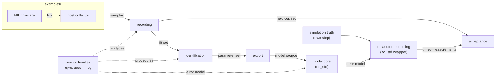
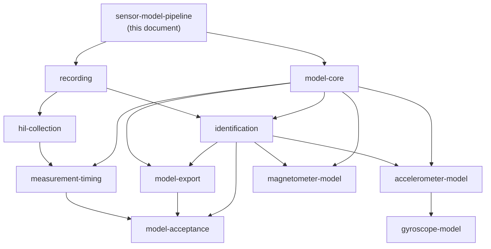

# Sensor Model Pipeline (sensor-model-pipeline)

---

### 1. Introduction

System and mission simulations need sensor models that reproduce the part a
vehicle actually carries. Datasheet values are typical, not guaranteed
(STMicroelectronics, 2024), and noise values taken from static data alone
lead an estimator to trust its sensor too much (ethz-asl, 2016). A model is
only as good as the recordings of that part on that board.

What a sensor reports is half of the model; when it reports is the other
half. Each measurement reflects truth filtered by the part's internal
filters, sampled on its own clock and timestamped after transfer and
processing delays (Li and Mourikis, 2014). The vendor of the first
reference part does not disclose those filters' transfer functions
(Borlini, 2021), so timing, like noise, has to be identified from data.

`control-rs-sensors` is a pipeline that turns a user's recordings into the
model their simulation needs. It ships sensor families, timing models that
wrap them and the procedures that identify both, not parameter sets for
specific parts.

This document is the overview. It fixes the pipeline's requirements, its
components and the interfaces between them. Each component and each sensor
family has its own design document (§4.3), which owns its technical design.
The first families are the gyroscope, accelerometer and magnetometer. The
LSM6DSOX and LIS3MDL are their reference parts.

Scenarios:

- **S1 Characterize a part.** A user records their sensor on a bench through
  a HIL example, identifies its error model and exports it.
- **S2 Simulate a mission.** A simulation instantiates exported models as
  measurement sources driven by truth state, reproducibly by seed.
- **S3 Accept a model.** A user checks an exported model against recordings
  held out of the identification and gets a pass or fail per parameter.
- **S4 Add a part.** A user models a new part of an existing family by
  recording and configuring it, without writing estimator code.
- **S5 Discretize a sensor.** A simulation with its own step drives a
  sensor that samples on its own clock, with its own bandwidth and latency,
  and delivers measurements when the real part would.
- **S6 Add a family.** A contributor adds a sensor family by writing its
  design and model without changing the shared components.

---

### 2. Requirements

#### 2.1 Functional Requirements

- **FR-1 — Recording provenance**: Every recording must identify the part,
  board, firmware revision, sensor settings and sample times. A parameter
  without this record cannot be traced to the evidence that produced it.
- **FR-2 — Link-agnostic ingestion**: The pipeline must build recordings
  from samples a user's example delivers over any link. It does not open
  ports or depend on a board.
- **FR-3 — Model identification**: From recordings, the pipeline must
  identify every parameter of a family's error model, stochastic and
  deterministic, and of its timing model, without user-written estimator
  code. Static-noise
  identification alone leaves scale-factor errors unaccounted for (ethz-asl,
  2016).
- **FR-4 — Parameter uncertainty**: Every identified parameter must carry an
  uncertainty derived from the estimate's statistics (Riley, 2008). A point
  value alone hides how much recording supports it.
- **FR-5 — Measurement synthesis from truth**: Given truth inputs, a
  parameter set and a sample interval, a model must produce measurements
  that apply every identified error term at that interval and within the
  part's range and resolution.
- **FR-6 — Model export**: The pipeline must export an identified model as
  source a `no_std` simulation compiles, and as a record of each parameter
  with value, unit, uncertainty and provenance.
- **FR-7 — Acceptance against held-out data**: The pipeline must compare
  measurements synthesized from an exported model with a recording held out
  of the identification, and report pass or fail per parameter (MathWorks,
  2026). A model that only reproduces its own training data is not evidence
  of fidelity.
- **FR-8 — Family extensibility**: A sensor family must reach recording,
  identification, export and acceptance through the shared interfaces of
  §4.2. A family that needs a change to a shared component is a change to
  that component's design, not a family-local exception.
- **FR-9 — Measurement timing**: A model must reproduce when each
  measurement reflects truth and when it becomes available: the part's
  bandwidth, its sampling instants on its own clock and its delivery
  latency, independent of the simulation's step. An unmodeled offset
  between sampling and timestamp reduces estimator accuracy, and a drifting
  one can make the estimator fail (Li and Mourikis, 2014).
- **FR-10 — Timing composition**: Timing models must wrap any family's
  error model without the family depending on them. A delay that is not a
  whole number of simulation steps must be represented, not rounded
  (Laakso et al., 1996).

#### 2.2 Non-Functional Requirements

- **NFR-1 — Reproducible synthesis**: The same parameters, truth inputs,
  sample interval and seed must produce bit-identical measurements on every
  run. Mission scenarios that cannot be replayed cannot be debugged or
  compared.
- **NFR-2 — Allocation-free synthesis**: Measurement synthesis must run in
  `no_std` without heap allocation and with bounded work per sample, so the
  same model runs in host simulation and on a target.

#### 2.3 Constraints

- **C-1 — Dependency boundary**: The library depends on `control-rs` only.
  Board, link and operating-system code lives in examples.
- **C-2 — Families, not parts**: The crate ships sensor families and
  identification procedures. It ships no part-specific parameter values
  outside tests and examples.
- **C-3 — Toolchain**: The crate follows `control-rs` (edition 2024,
  `rust-version = "1.89"`) and runs its gates through `control-rs-ci` built
  from the pinned `control-rs` revision.

---

### 3. Technical Overview

Seven shared components carry every family. A family contributes its error
model, its identification procedures and its recording run types. The
measurement-timing component wraps the family's error model in the part's
bandwidth, sampling clock and latency, so a simulation sees discrete
measurements at the times the real part would deliver them.

Required expertise: inertial sensor error modeling, estimation statistics,
embedded Rust and bench instrumentation.

---

### 4. Architecture

#### 4.1 Components

| Component | Responsibility | Location | Build |
|:--|:--|:--|:--|
| Model core | Sensor model contract, truth inputs, measurement message, random sources | `src/sim/` | `no_std`, no heap |
| Measurement timing | Bandwidth, sampling clock, latency and delivery wrappers around any error model | `src/timing/` | `no_std`, no heap |
| Recording | Sample and provenance schema, reader and writer | `src/collect/` | `no_std` schema, `std` writer |
| HIL collection | Firmware and host-collector conventions, HIL gates | `examples/`, `.cargo/gate.toml` | target and host |
| Identification | Shared estimation machinery and uncertainty | `src/fit/` | `std` |
| Export | Generated source, parameter record, interchange formats | `src/export/` | `std` |
| Acceptance | Synthesized-versus-held-out comparison and verdict | `src/accept/` | `std` |
| Sensor families | Error model, procedures and run types per family | `src/sim/`, `src/fit/` by family | as above |

#### 4.2 Interfaces

Components meet at six artifacts. Each is owned by one component's design
document; the others consume it as specified there.

| Artifact | Producer | Consumers | Owner |
|:--|:--|:--|:--|
| Recording: samples, sample times, run type, provenance (FR-1) | HIL collection through Recording | Identification, Acceptance | `recording` |
| Parameter set: values, units, uncertainty, provenance per parameter (FR-4) | Identification with a family's procedures | Export, Model core | `identification` |
| Sensor model contract: truth inputs, parameters, seed and interval in; measurement message out (FR-5) | Model core with a family's error model | Acceptance, user simulations | `model-core` |
| Timed measurement: error-model output passed through bandwidth, sampled on the sensor clock, with measurement and availability times (FR-9, FR-10) | Measurement timing wrapping Model core | Acceptance, user simulations | `measurement-timing` |
| Exported model: source and record (FR-6) | Export | User simulations, Acceptance | `model-export` |
| Verdict: pass or fail per parameter with evidence (FR-7) | Acceptance | User, HIL gates | `model-acceptance` |

The sensor model contract is timeless: one truth sample in, one error-model
output out. Measurement timing owns every notion of time around it, so a
family never sees a clock. The timed measurement follows the sensor
boundary in Tawny `model-interconnect.md` §4.9: measurement time,
availability time, payload and a valid flag, with truth never reaching the
payload without its error terms.

#### 4.3 Document Map

One design document per component and per sensor family, under
`documentation/sensors/<slug>-design.md`. Parts do not get documents (C-2);
the LSM6DSOX and LIS3MDL appear in the family documents as reference parts
for HIL examples and acceptance runs.

| Document | Kind | Scope | Requirements it discharges | Depends on |
|:--|:--|:--|:--|:--|
| `model-core` | component | Model contract, truth inputs, message, random sources, discretization | FR-5, NFR-1, NFR-2 | — |
| `measurement-timing` | component | Bandwidth, sampling clock, latency and delivery models; their identification and timing run types | FR-3, FR-9, FR-10 | `model-core`, `hil-collection` |
| `recording` | component | Schema, provenance, run types, codec | FR-1, FR-2 | — |
| `hil-collection` | component | HIL example contract, host collector, time alignment, HIL gates | FR-1, FR-2 | `recording` |
| `identification` | component | Shared estimators, uncertainty, fit and held-out split | FR-3, FR-4 | `recording`, `model-core` |
| `model-export` | component | Generated source, parameter record, interchange formats | FR-6 | `identification`, `model-core` |
| `model-acceptance` | component | Comparison statistics and verdict | FR-7 | `identification`, `model-export` |
| `gyroscope-model` | family | Error model, procedures, run types | FR-3, FR-5, FR-8 | `model-core`, `identification`, `accelerometer-model` |
| `accelerometer-model` | family | Error model, procedures, run types | FR-3, FR-5, FR-8 | `model-core`, `identification` |
| `magnetometer-model` | family | Error model incl. distortion and current interference, procedures, run types | FR-3, FR-5, FR-8 | `model-core`, `identification` |

`gyroscope-model` depends on `accelerometer-model` on the assumption that
the reference calibration method (Tedaldi et al., 2014) recovers gyroscope
parameters after the accelerometer's; that document confirms or removes the
edge. Later families (barometer, rangefinder, current and
voltage, encoder, temperature, GNSS) are added as rows here, each with its
own document.

Each document follows the control-rs pipeline: `/cr-research` on its slug,
then `/cr-design-doc`, approval, then `/cr-implement`. The research file
`research/sensor-model-pipeline.json` is a prior file for every child
pass.

#### 4.4 Layout and Gates

The library has no dependency beyond `control-rs` (C-1). Firmware crates
live under `examples/hil/` outside the workspace; host collectors are
examples with example-only dependencies. HIL gates are `default = false`
and `required = false` in `.cargo/gate.toml`, so CI runs host gates only.

---

### 5. Alternatives

- **One design for the whole pipeline.** A single document mixes interface
  decisions with component internals, so any internal change reopens the
  whole approval. Per-component documents let each be approved and traced
  on its own.
- **One document per part.** It would duplicate the error model and
  procedures for every part of a family and contradicts C-2. Parts are
  configurations of a family.
- **Timing inside each family.** Each family could model its own filter and
  latency. That duplicates the same clock, delay and filter machinery three
  times and ties every family to the simulation's step. A wrapper keeps
  families timeless and lets one timing model serve every family (FR-10).
- **Whole-step delays.** Rounding latency to the simulation step is simple
  but makes the model depend on the step chosen. Fractional delay filters
  interpolate between samples and allow a continuously varying delay
  (Laakso et al., 1996).
- **One inertial-sensor document.** The three families share a model
  structure but differ in truth inputs (rate, specific force, field and
  supply current) and in calibration procedure (Tedaldi et al., 2014; Liu et
  al., 2014). Shared structure lives in `model-core`; the differences get a
  document each.

---

### 6. Verification & Validation

#### 6.1 Verification

This document's requirements are discharged by its child documents. Each
`link` condition takes the status of the child document it names.

| Condition | Requirement | Method | Target | Criterion |
|:--|:--|:--|:--|:--|
| VC-1.1 | FR-1 | `link` | `recording` `hil-collection` | Both documents trace with every condition verified; FR-1 holds iff this condition holds |
| VC-2.1 | FR-2 | `link` | `recording` `hil-collection` | Both documents trace with every condition verified; FR-2 holds iff this condition holds |
| VC-3.1 | FR-3 | `link` | `identification` `measurement-timing` `gyroscope-model` `accelerometer-model` `magnetometer-model` | All five documents trace with every condition verified; FR-3 holds iff this condition holds |
| VC-4.1 | FR-4 | `link` | `identification` | The document traces with every condition verified; FR-4 holds iff this condition holds |
| VC-5.1 | FR-5 | `link` | `model-core` `gyroscope-model` `accelerometer-model` `magnetometer-model` | All four documents trace with every condition verified; FR-5 holds iff this condition holds |
| VC-6.1 | FR-6 | `link` | `model-export` | The document traces with every condition verified; FR-6 holds iff this condition holds |
| VC-7.1 | FR-7 | `link` | `model-acceptance` | The document traces with every condition verified; FR-7 holds iff this condition holds |
| VC-8.1 | FR-8 | `link` | `gyroscope-model` `accelerometer-model` `magnetometer-model` | All three family documents trace with every condition verified; FR-8 holds iff this condition holds |
| VC-9.1 | FR-9 | `link` | `measurement-timing` `hil-collection` | Both documents trace with every condition verified; FR-9 holds iff this condition holds |
| VC-10.1 | FR-10 | `link` | `measurement-timing` `gyroscope-model` `accelerometer-model` `magnetometer-model` | All four documents trace with every condition verified; FR-10 holds iff this condition holds |
| VC-11.1 | NFR-1 | `link` | `model-core` `measurement-timing` | Both documents trace with every condition verified; NFR-1 holds iff this condition holds |
| VC-12.1 | NFR-2 | `gate` | `no-std` | The library builds for `thumbv7em-none-eabihf` without `alloc`; NFR-2 holds iff this condition holds |
| VC-13.1 | C-1 | `gate` | `deps` | The library's normal dependency tree at depth 1 contains `control-rs` and nothing else; C-1 holds iff this condition holds |
| VC-14.1 | C-2 | `gate` | `no-part-values` | No file under `src/` outside test modules names a part number; C-2 holds iff this condition holds |
| VC-15.1 | C-3 | `gate` | `fetch` | The runner resolves `control-rs` at the revision pinned in `Cargo.lock`; C-3 holds iff this condition holds |

#### 6.3 Limits

- A `link` condition is only as strong as the child document it names. Until
  a child document exists and is traced, its conditions here are
  unverified.
- Fidelity on real parts rests on acceptance runs from HIL gates, which CI
  does not run.

---

### 8. Risks & Open Questions

Each open question is assigned to the document that resolves it.

| Question | Owner |
|:--|:--|
| Temperature dependence of bias and scale: model input only, or identified from thermal runs (STMicroelectronics, 2024; STMicroelectronics, 2017) | family documents |
| Latency and clock alignment between target timestamps and host receive time | `hil-collection` |
| Bandwidth and group delay need excitation with a timing reference (rate table, shaker or synchronized step), because the internal filters are undisclosed (Borlini, 2021) | `measurement-timing`, `hil-collection` |
| Clock drift and jitter models for the sensor clock relative to simulation time | `measurement-timing` |
| Whether `control-rs` exposes the `no_std` float functions random sources need, or C-1 needs a `libm` exception | `model-core` |
| Recording length for slow error terms: at least 3 hours for bias random walk (Buchanan, 2026) keeps HIL gates out of routine CI | `identification`, `hil-collection` |
| Normative term definitions (IEEE Std 952, IEEE Std 1293) were not retrieved | `identification` |

---

### 9. Development Plan

Each phase writes, approves and implements the documents it names.

| Phase | Delivers | Requirements | Effort | Status |
|:--|:--|:--|:--|:--|
| 1. Contracts | `model-core` and `recording` designs and implementations; `no-std`, `deps`, `no-part-values` gates | FR-1, FR-2, FR-5, NFR-1, NFR-2, C-1, C-2, C-3 | 6 days | Planned |
| 2. Identification and collection | `identification` and `hil-collection`; LSM6DSOX + LIS3MDL HIL example | FR-3, FR-4 | 7 days | Planned |
| 3. Inertial families and timing | `accelerometer-model`, `gyroscope-model`, `magnetometer-model`, `measurement-timing` | FR-3, FR-5, FR-8, FR-9, FR-10 | 14 days | Planned |
| 4. Export and acceptance | `model-export` and `model-acceptance` | FR-6, FR-7 | 5 days | Planned |

---

### 10. Revision History

| Revision | Date | Author | Description |
|:--|:--|:--|:--|
| 1.0 | October 30, 2026 | @MitchellDScott, Claude | Initial design: FR-1 to FR-8, NFR-1, NFR-2, C-1 to C-3. |
| 2.0 | October 30, 2026 | @MitchellDScott, Claude | Restructured as the overview. Sensor and component internals removed; they belong to the child documents in §4.3. FR-3 to FR-7 generalized and renumbered (calibration merged into FR-3); FR-8 Family extensibility added; FR-1 to FR-8 verified by `link` to child documents. |
| 3.0 | October 30, 2026 | @MitchellDScott, Claude | Measurement timing added: FR-9 Measurement timing, FR-10 Timing composition, scenario S5; FR-3 extended to timing parameters; `measurement-timing` component and timed-measurement interface; NFR-1 also linked to `measurement-timing`. |

---

## References

[1] STMicroelectronics, "LSM6DSOX: iNEMO inertial module with Machine
    Learning Core, Finite State Machine and advanced Digital Functions,"
    STMicroelectronics, Datasheet DS12814 Rev 4, 2024. [Online]. Available:
    https://www.st.com/resource/en/datasheet/lsm6dsox.pdf. Accessed:
    Oct. 30, 2026.

[2] ethz-asl, "IMU Noise Model," *kalibr GitHub wiki*. [Online]. Available:
    https://github.com/ethz-asl/kalibr/wiki/IMU-Noise-Model. Accessed:
    Oct. 30, 2026.

[3] M. Li and A. I. Mourikis, "Online temporal calibration for camera-IMU
    systems: Theory and algorithms," *Int. J. Robot. Res.*, 2014.
    [Online]. Available:
    https://intra.ece.ucr.edu/~mourikis/papers/Li2014IJRR_timing.pdf.
    Accessed: Oct. 30, 2026.

[4] E. Borlini, "What are the transfer functions of LPF1 and LPF2 for
    LSM6DSOX?," *ST Community, MEMS sensors forum*, May 2021. [Online].
    Available:
    https://community.st.com/mems-sensors-48/what-are-the-transfer-functions-of-lpf1-and-lpf2-for-lsm6dsox-25081.
    Accessed: Oct. 30, 2026.

[5] W. J. Riley, "Handbook of frequency stability analysis," National
    Institute of Standards and Technology, Boulder, CO, USA, NIST Special
    Publication 1065, 2008.

[6] MathWorks, "Inertial Sensor Noise Analysis Using Allan Variance,"
    *Navigation Toolbox documentation*. [Online]. Available:
    https://ch.mathworks.com/help/nav/ug/inertial-sensor-noise-analysis-using-allan-variance.html.
    Accessed: Oct. 30, 2026.

[7] T. I. Laakso, V. Välimäki, M. Karjalainen, and U. K. Laine, "Splitting
    the unit delay: Tools for fractional delay filter design," *IEEE Signal
    Process. Mag.*, vol. 13, no. 1, pp. 30–60, Jan. 1996,
    doi: 10.1109/79.482137.

[8] D. Tedaldi, A. Pretto, and E. Menegatti, "imu_tk README," in
    *Kyle-ak/imu_tk*, implementing "A robust and easy to implement method
    for IMU calibration without external equipments," Proc. IEEE ICRA,
    Hong Kong, China, 2014, pp. 3042–3049. [Online]. Available:
    https://github.com/Kyle-ak/imu_tk. Accessed: Oct. 30, 2026.

[9] Y. X. Liu, X. S. Li, X. J. Zhang, and Y. B. Feng, "Novel calibration
    algorithm for a three-axis strapdown magnetometer," *Sensors*, vol. 14,
    no. 5, pp. 8485–8504, 2014, doi: 10.3390/s140508485.

[10] STMicroelectronics, "LIS3MDL: Digital output magnetic sensor:
    ultralow-power, high-performance 3-axis magnetometer,"
    STMicroelectronics, Datasheet DocID024204 Rev 6, 2017. [Online].
    Available: https://www.espruino.com/datasheets/LIS3MDL.pdf. Accessed:
    Oct. 30, 2026.

[11] R. Buchanan, *allan_variance_ros*: Allan variance computation for IMU
     rosbags (BSD-3-Clause). Oxford Robotics Institute, DRS Lab. [Online].
     Available: https://github.com/ori-drs/allan_variance_ros. Accessed:
     Oct. 30, 2026.
